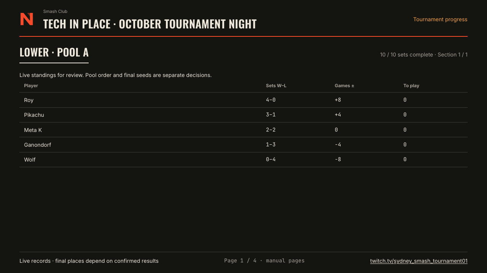
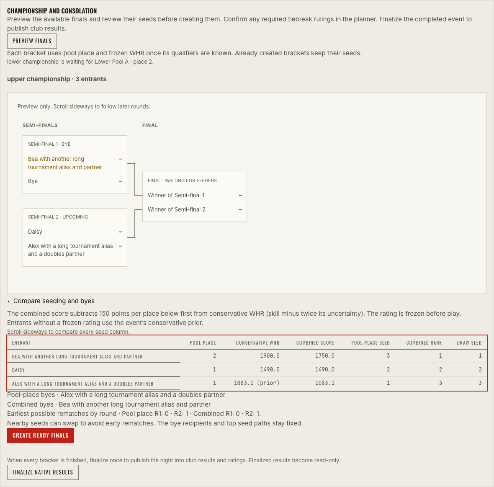
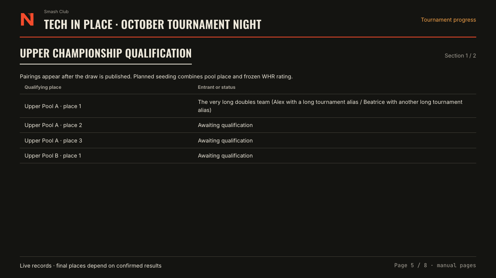
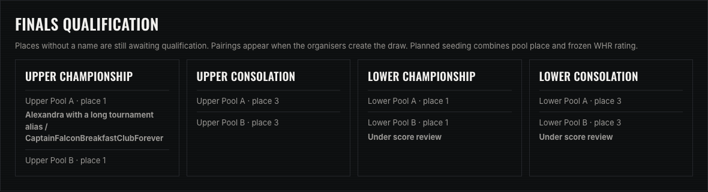
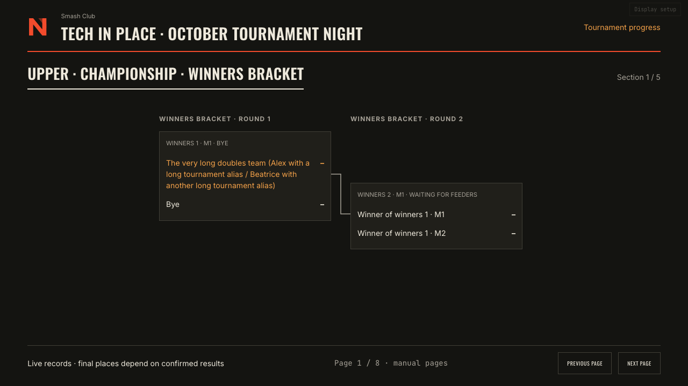
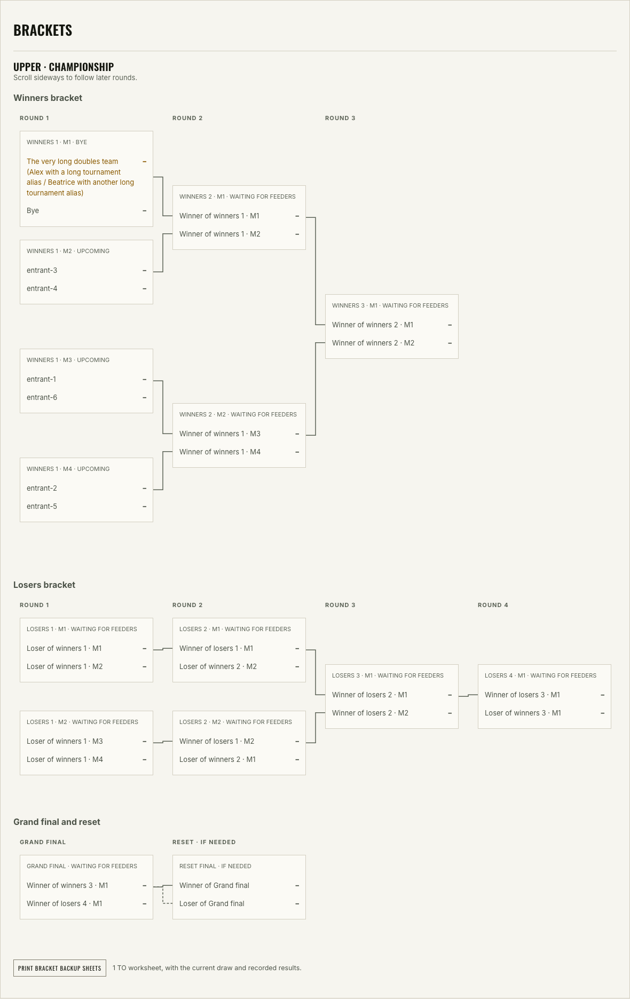

# Nemesis changelog

Dates show when each change landed, in Sydney time. Select a version to open its GitHub release.

## 0.23.10

### Patch Changes

- 23 November 2026 · **Fix** · Player profiles explain why a rating is provisional and how rookie sets count. [#618](https://github.com/ashleylamont/smashclub-seeding/pull/618) · [build 316e170](https://github.com/ashleylamont/smashclub-seeding/commit/316e170b148c3df1b68e1bba583873fece83b680)
- 23 November 2026 · **Fix** · Give GitHub more time to link a merged version before publishing the verified Nemesis release. [#619](https://github.com/ashleylamont/smashclub-seeding/pull/619) · [build 3d27e01](https://github.com/ashleylamont/smashclub-seeding/commit/3d27e0131a03d317143ed76a54a15e6b1c295e75)

## 0.23.9

### Patch Changes

- 23 November 2026 · **Fix** · Print the recorded scores and winners from a published bracket in Standings / draw. [#613](https://github.com/ashleylamont/smashclub-seeding/pull/613) · [build 1932a7d](https://github.com/ashleylamont/smashclub-seeding/commit/1932a7da034f1c2270017855fe94bb8c65c75e79)

## 0.23.8

### Patch Changes

- 23 November 2026 · **Fix** · Your account only offers sign-in providers the site supports. You can still see the providers you’ve already linked. [#612](https://github.com/ashleylamont/smashclub-seeding/pull/612) · [build c4c013a](https://github.com/ashleylamont/smashclub-seeding/commit/c4c013a3a8ccba16544d880256981d42ae0e4ae2)

## 0.23.7

### Patch Changes

- 23 November 2026 · **Fix** · Warn organisers before saving a shared setup limit below the number of active matches, so they know existing matches stay in place and new calls will wait. [#605](https://github.com/ashleylamont/smashclub-seeding/pull/605) · [build 144b26b](https://github.com/ashleylamont/smashclub-seeding/commit/144b26bae621743068e938651cbc994e11011c2c)

## 0.23.6

### Patch Changes

- 23 November 2026 · **Fix** · See the knockout draw’s status and what locking or pausing does in Standings / draw. [#594](https://github.com/ashleylamont/smashclub-seeding/pull/594) · [build e70229a](https://github.com/ashleylamont/smashclub-seeding/commit/e70229a10502bff0e26b69e234a3ad977d14815f)
- 23 November 2026 · **Maintenance** · Speed up release verification by running Linux browser checks against the packaged Nemesis web app. [#596](https://github.com/ashleylamont/smashclub-seeding/pull/596) · [build 7fb47a9](https://github.com/ashleylamont/smashclub-seeding/commit/7fb47a9b7135e6e51a2d130d4894a014f3ed4d2d)
- 23 November 2026 · **Improvement** · In OBS Display setup, turn on **Use event Twitch announcement** to show the channel announced in Broadcast. Copy the updated source URL to keep the choice. [#604](https://github.com/ashleylamont/smashclub-seeding/pull/604) · [build 1d1f87b](https://github.com/ashleylamont/smashclub-seeding/commit/1d1f87b0c1742694cb5098ffd220f0597e2f2476)
- 23 November 2026 · **Fix** · Event Night shows the match count without queue instructions when you browse a player’s matches. [#601](https://github.com/ashleylamont/smashclub-seeding/pull/601) · [build 6e5e3ef](https://github.com/ashleylamont/smashclub-seeding/commit/6e5e3ef48205010521cd178e3e89de56bb90b5e2)
- 23 November 2026 · **Feature** · Turn on Include profile mains in a finished bracket or division’s PNG preview to add players’ saved characters below the standings. [#597](https://github.com/ashleylamont/smashclub-seeding/pull/597) · [build a768017](https://github.com/ashleylamont/smashclub-seeding/commit/a768017c702af10f7029384dca897aafacb2f8d4)
- 23 November 2026 · **Fix** · Read both player names and the recorded result in the tournament archive on your phone. [#602](https://github.com/ashleylamont/smashclub-seeding/pull/602) · [build 3bcfb5e](https://github.com/ashleylamont/smashclub-seeding/commit/3bcfb5e7dbcc6970d4371870d2c7e79ddc5dd5f4)
- 23 November 2026 · **Fix** · Organisers can open the unplayed finals removal review when an attendance change is blocked, then return to their draft and refresh the preview. [#609](https://github.com/ashleylamont/smashclub-seeding/pull/609) · [build b8696c0](https://github.com/ashleylamont/smashclub-seeding/commit/b8696c07041635397f90bf36482c8af7d6d12040)

## 0.23.5

### Patch Changes

- 23 November 2026 · **Improvement** · Read a dated example of how a bracket win can narrow a skill gap while opponents remain higher in the club rankings. [#592](https://github.com/ashleylamont/smashclub-seeding/pull/592) · [build e72418f](https://github.com/ashleylamont/smashclub-seeding/commit/e72418fa940047e7e6f58f39feedba789ece9bb4)
- 23 November 2026 · **Improvement** · Open a linked player’s profile preview from a recorded singles match in the Event Night archive. [#586](https://github.com/ashleylamont/smashclub-seeding/pull/586) · [build 6f44689](https://github.com/ashleylamont/smashclub-seeding/commit/6f44689d09e026fec4cc3694054735cf25bbdf15)
- 23 November 2026 · **Maintenance** · Verify that organisers can manually refresh and retry event history without the background poll taking over the test. [#585](https://github.com/ashleylamont/smashclub-seeding/pull/585) · [build 4e0077a](https://github.com/ashleylamont/smashclub-seeding/commit/4e0077a155b1bd1c9fdf44a078768e34a242d3e2)
- 23 November 2026 · **Maintenance** · Wait for the intended Match view option to receive keyboard focus before pressing Enter in browser tests. [#589](https://github.com/ashleylamont/smashclub-seeding/pull/589) · [build 2ffbea1](https://github.com/ashleylamont/smashclub-seeding/commit/2ffbea117a3a6c81feab0e851f57ef51d303563c)
- 23 November 2026 · **Feature** · Choose which pages an OBS source shows during intermission. Display setup keeps the choice in the copied source URL. [#593](https://github.com/ashleylamont/smashclub-seeding/pull/593) · [build bfc9750](https://github.com/ashleylamont/smashclub-seeding/commit/bfc975081e690b3d5b993fd873a19ccedf006794)
- 23 November 2026 · **Maintenance** · Keep results artwork and finals recovery browser checks consistent for the packaged Nemesis app. [#580](https://github.com/ashleylamont/smashclub-seeding/pull/580) · [build 54786fe](https://github.com/ashleylamont/smashclub-seeding/commit/54786feaa11135759ffc1bca7f1f2bcf7fd5cfef)
- 23 November 2026 · **Improvement** · Hide the score-reporting QR on a single OBS source from Display setup. Copy the updated source URL to keep that choice in OBS. [#584](https://github.com/ashleylamont/smashclub-seeding/pull/584) · [build fe82c55](https://github.com/ashleylamont/smashclub-seeding/commit/fe82c55ecd296fc51e40cad4f259c258700cd8fd)
- 23 November 2026 · **Improvement** · Read a short summary of each past Nemesis release before opening the full changelog. [#577](https://github.com/ashleylamont/smashclub-seeding/pull/577) · [build d5ed5fc](https://github.com/ashleylamont/smashclub-seeding/commit/d5ed5fcc04722abf7f9447daa6c666c92e61d240)
- 23 November 2026 · **Fix** · Organisers can jump to the guarded Return action when an untaken match call blocks moving two players out of a pool. [#595](https://github.com/ashleylamont/smashclub-seeding/pull/595) · [build 1b2438f](https://github.com/ashleylamont/smashclub-seeding/commit/1b2438fdbe5502f28db3c733fa530e0a26e547ae)
- 23 November 2026 · **Improvement** · Scan the highlights from recent Nemesis updates in Changelog. Open an update for full notes or expand Older releases to browse the archive. [#579](https://github.com/ashleylamont/smashclub-seeding/pull/579) · [build 707ee00](https://github.com/ashleylamont/smashclub-seeding/commit/707ee008e3b4f0ff304ffa9fa689fb8c8b53c4c1)
- 23 November 2026 · **Fix** · Wait for pool standings colors to settle before scanning contrast in the browser rehearsal. [#588](https://github.com/ashleylamont/smashclub-seeding/pull/588) · [build 880a6bf](https://github.com/ashleylamont/smashclub-seeding/commit/880a6bfc4d7fe295e460d3a883597736d0f73d66)

## 0.23.4

### Patch Changes

- 23 November 2026 · **Improvement** · The **Report characters played** button takes up less space on recorded sets, with a 44px-tall tap target on phones. [#578](https://github.com/ashleylamont/smashclub-seeding/pull/578) · [build 9ccde76](https://github.com/ashleylamont/smashclub-seeding/commit/9ccde7683bfa208f55e3c0435931b5d57d58dfa3)
- 23 November 2026 · **Improvement** · Preview a linked singles player from a tournament's standings, participants or match results without leaving the tournament. [#576](https://github.com/ashleylamont/smashclub-seeding/pull/576) · [build 963d445](https://github.com/ashleylamont/smashclub-seeding/commit/963d44535edc258daaccd876fd022b8076f2b9f1)
- 23 November 2026 · **Fix** · Match Log flags outdated WHR evidence while ratings update after a score correction. [#575](https://github.com/ashleylamont/smashclub-seeding/pull/575) · [build 771998e](https://github.com/ashleylamont/smashclub-seeding/commit/771998e61873521c3f5df8241d2e62e603bd5ab6)

## 0.23.3

### Patch Changes

- 23 November 2026 · **Fix** · When an untaken match call blocks a late singles entry, the attendance preview links to that pairing. Return the call, then refresh the preview to review the new matches before adding the player. If a score arrives before the call is returned, review it first. [#570](https://github.com/ashleylamont/smashclub-seeding/pull/570) · [build 60311c8](https://github.com/ashleylamont/smashclub-seeding/commit/60311c8fd870b64d2bfd966fa6d8c76096c30a47)
- 23 November 2026 · **Improvement** · Choose one or two recent sets for the gameplay sidebar in OBS Display setup. The preview updates immediately, and the copied source URL keeps your choice. [#568](https://github.com/ashleylamont/smashclub-seeding/pull/568) · [build 91a389a](https://github.com/ashleylamont/smashclub-seeding/commit/91a389a60a5e2a27d56b858eb6f002b23828b8ff)
- 23 November 2026 · **Fix** · The organiser desk shows when tournament results are ready to publish and explains outstanding steps. [#569](https://github.com/ashleylamont/smashclub-seeding/pull/569) · [build 06e6153](https://github.com/ashleylamont/smashclub-seeding/commit/06e615359affb92443b480a0c0e5fbf6392c9d71)
- 23 November 2026 · **Fix** · The Match view menu now says when a view shows only some results. Choose Recorded results to find every confirmed score in your current filters. [#567](https://github.com/ashleylamont/smashclub-seeding/pull/567) · [build 8a51d21](https://github.com/ashleylamont/smashclub-seeding/commit/8a51d214d6da32952e63521b71a7560a78f3217d)
- 23 November 2026 · **Fix** · Remove empty pool links from finished knockout pages so brackets and recorded results are easier to find. [#566](https://github.com/ashleylamont/smashclub-seeding/pull/566) · [build 13a963c](https://github.com/ashleylamont/smashclub-seeding/commit/13a963cd16b10d8d08aa6e8aba9e030f49f34736)
- 23 November 2026 · **Improvement** · Open **How to read the board** on Rankings to see how tournament placing and bracket seeds relate to club ratings. [#574](https://github.com/ashleylamont/smashclub-seeding/pull/574) · [build c643ec8](https://github.com/ashleylamont/smashclub-seeding/commit/c643ec8023b18c22835e7f521ff1003bd625cd63)
- 23 November 2026 · **Fix** · Head to Head keeps the verified skill gap for a shared night when the earlier estimate is unavailable. Played results, the current win estimate and attendance deductions stay visible. [#555](https://github.com/ashleylamont/smashclub-seeding/pull/555) · [build 0f70df1](https://github.com/ashleylamont/smashclub-seeding/commit/0f70df16f51473eb417af44b7b687cd9745a568e)

## 0.23.2

Published Nemesis doubles standings let you preview either registered teammate, and Rankings and recaps show rank movement when earlier standings support the comparison. From a Broadcast preview, open **Display setup** and copy the OBS source, including on phones.

### Patch Changes

- 23 November 2026 · **Fix** · Clear live finalization prompts when an event ends so organisers can find the draw and published score corrections. [#551](https://github.com/ashleylamont/smashclub-seeding/pull/551) · [build a1d6388](https://github.com/ashleylamont/smashclub-seeding/commit/a1d6388b85aec71342709f87946826237e1f9542)
- 23 November 2026 · **Fix** · Open Display setup from a Broadcast preview, including on phones. Use Copy for a clean OBS link. [#552](https://github.com/ashleylamont/smashclub-seeding/pull/552) · [build 796f6ea](https://github.com/ashleylamont/smashclub-seeding/commit/796f6ea1d145a12e869c05181887e3914a8a730f)
- 23 November 2026 · **Fix** · See when a past night’s rating estimate is unavailable. Your player profile still shows recorded sets, attendance changes, and estimates from the latest rating update. [#539](https://github.com/ashleylamont/smashclub-seeding/pull/539) · [build da404ed](https://github.com/ashleylamont/smashclub-seeding/commit/da404ede0a19a5b42205ff7aa576197bc8d26990)
- 23 November 2026 · **Improvement** · Open each player's profile preview from the standings for a published Nemesis doubles event. [#553](https://github.com/ashleylamont/smashclub-seeding/pull/553) · [build da940b8](https://github.com/ashleylamont/smashclub-seeding/commit/da940b802bec45993d24c46a35b498ec764e5784)
- 23 November 2026 · **Maintenance** · Restore the checks that verify each Nemesis build. [#561](https://github.com/ashleylamont/smashclub-seeding/pull/561) · [build ae1efac](https://github.com/ashleylamont/smashclub-seeding/commit/ae1efacd7a459318da748c98495dbe9886b34dda)
- 23 November 2026 · **Maintenance** · Keep verified release candidates moving while later changes are prepared for the next version. [#543](https://github.com/ashleylamont/smashclub-seeding/pull/543) · [build 4e8189b](https://github.com/ashleylamont/smashclub-seeding/commit/4e8189bdb18b431ff830984d18a947aeafb4a33a)
- 23 November 2026 · **Fix** · Rankings and event recaps only show rank changes when there are reliable earlier standings to compare against. Current rankings still appear. [#556](https://github.com/ashleylamont/smashclub-seeding/pull/556) · [build c52b208](https://github.com/ashleylamont/smashclub-seeding/commit/c52b208a727e61e63baf34d52ca17c7b53e33fbe)

## 0.23.1

Rankings labels your active rank when it hides inactive players, and player profiles label your published club rank. Use **Try again** after a temporary results error, and keep reading the results you already opened if a refresh fails.

### Patch Changes

- 23 November 2026 · **Fix** · Rankings explains what the conservative estimate measures and why it can differ from bracket seeds. [#536](https://github.com/ashleylamont/smashclub-seeding/pull/536) · [build a3f96fa](https://github.com/ashleylamont/smashclub-seeding/commit/a3f96faab4ceed2d6d82165e95700d53e785b4c0)
- 23 November 2026 · **Fix** · Clarify active and published ranks on Rankings and player profiles. Label club rating and explain when rookie anchoring adjusts the current skill estimate. [#526](https://github.com/ashleylamont/smashclub-seeding/pull/526) · [build 886ea1f](https://github.com/ashleylamont/smashclub-seeding/commit/886ea1f9f262124626571dbb0585b5f322fb87dd)
- 23 November 2026 · **Improvement** · Open Changelog in the Nemesis footer to see new features and fixes first, with maintenance below. GitHub release notes use the same layout. [#534](https://github.com/ashleylamont/smashclub-seeding/pull/534) · [build 11629a0](https://github.com/ashleylamont/smashclub-seeding/commit/11629a0e62ea572340f3f268fe040b8ed0483564)
- 23 November 2026 · **Fix** · After live play ends, the organiser desk shows where to correct published scores. Cancelled events are labelled separately. [#538](https://github.com/ashleylamont/smashclub-seeding/pull/538) · [build 4f2127f](https://github.com/ashleylamont/smashclub-seeding/commit/4f2127f2e298e86cec0e861d4e9cde6355341d6f)
- 23 November 2026 · **Maintenance** · Add an offline comparison to test whether doubles pair ratings predict future club nights better than singles ratings alone. [#532](https://github.com/ashleylamont/smashclub-seeding/pull/532) · [build 2014a29](https://github.com/ashleylamont/smashclub-seeding/commit/2014a29e8cde46939c05b36ad9fd52121db3cdae)
- 23 November 2026 · **Fix** · Return keyboard focus to Display setup when you close it on an OBS preview. [#554](https://github.com/ashleylamont/smashclub-seeding/pull/554) · [build 0b2e5a6](https://github.com/ashleylamont/smashclub-seeding/commit/0b2e5a6dce15e6f3fb1ce07b1112e6eef1abe1d1)
- 23 November 2026 · **Fix** · Retry a tournament or event results page without reloading the tab. If a refresh fails, you can still read the results you already opened. [#537](https://github.com/ashleylamont/smashclub-seeding/pull/537) · [build dafdf47](https://github.com/ashleylamont/smashclub-seeding/commit/dafdf47863bfc9bef81a3b5df36daeae76a8edee)
- 23 November 2026 · **Fix** · Keep the dates in your rating history and night picker the same when you change time zones. [#550](https://github.com/ashleylamont/smashclub-seeding/pull/550) · [build 43a6434](https://github.com/ashleylamont/smashclub-seeding/commit/43a643418687fa51389f9aee2922c3adbbe72eec)
- 23 November 2026 · **Maintenance** · Verify numbered release builds against the source used for their release notes, including when other changes have already landed. [#542](https://github.com/ashleylamont/smashclub-seeding/pull/542) · [build ee9723e](https://github.com/ashleylamont/smashclub-seeding/commit/ee9723e38948ab1e5a65b65346f241c61f2cb2cb)

## 0.23.0

Organisers can switch OBS between gameplay, tournament progress and automatic intermissions from Broadcast when OBS uses the **Follow event** source. You can also preview a registered doubles teammate from a live pool, bracket or match card.

### Minor Changes

- 23 November 2026 · **Feature** · Switch OBS between gameplay, tournament progress and automatic intermissions from the TO desk. Use the Follow event overlay in OBS to receive those changes. [#514](https://github.com/ashleylamont/smashclub-seeding/pull/514) · [build 4609418](https://github.com/ashleylamont/smashclub-seeding/commit/4609418adadc137f9ee52696ef2112425e35968d)

### Patch Changes

- 23 November 2026 · **Fix** · Explain the current attendance policy on the rankings page, including when missed nights carry no penalty. [#523](https://github.com/ashleylamont/smashclub-seeding/pull/523) · [build 7d699d6](https://github.com/ashleylamont/smashclub-seeding/commit/7d699d64272f896902bbe8bb5d4219598281fbc9)
- 23 November 2026 · **Fix** · Recaps label win estimates as pre-night WHR odds and display very small chances the same way as match history. [#521](https://github.com/ashleylamont/smashclub-seeding/pull/521) · [build 5ed237a](https://github.com/ashleylamont/smashclub-seeding/commit/5ed237ae7838a212007de36ae1ceaf526d4f34ac)
- 23 November 2026 · **Fix** · Open public player previews for registered doubles teammates from live pools, match cards, brackets, and native event results. [#524](https://github.com/ashleylamont/smashclub-seeding/pull/524) · [build 94059c1](https://github.com/ashleylamont/smashclub-seeding/commit/94059c100b922ec3fd76df3c083e3e2c77fe47d3)
- 23 November 2026 · **Fix** · Try an event short link again without reloading Nemesis, and keep the chosen pool and results section when the link opens. [#519](https://github.com/ashleylamont/smashclub-seeding/pull/519) · [build b3aab6a](https://github.com/ashleylamont/smashclub-seeding/commit/b3aab6a84697e8b33685d0ea4b6ddfa94144ecd4)

## 0.22.1

Preview a player's mains, club rating and rated-set record from Rankings, event standings or live singles views. If GitHub posting is enabled, you can review and submit a public issue from Nemesis without a GitHub account.

### Patch Changes

- 23 November 2026 · **Fix** · Explain when club ratings appear on the homepage before the first rated results publish. [#490](https://github.com/ashleylamont/smashclub-seeding/pull/490) · [build 11a5af2](https://github.com/ashleylamont/smashclub-seeding/commit/11a5af210141e1d23f2fcf5c8066aabb9b02a2f2)
- 23 November 2026 · **Fix** · Show event planner instructions for the configured tournament format, including native knockouts, playoffs without consolation, and Challonge handoff. [#476](https://github.com/ashleylamont/smashclub-seeding/pull/476) · [build ae6abb3](https://github.com/ashleylamont/smashclub-seeding/commit/ae6abb36080f4817e6356b418a97de8b9125c1c0)
- 23 November 2026 · **Fix** · Show the winner of a forfeited set in the active player pool schedule and omit placeholder game scores. [#473](https://github.com/ashleylamont/smashclub-seeding/pull/473) · [build e139b44](https://github.com/ashleylamont/smashclub-seeding/commit/e139b449668d85668a288d1cc3f25ef79fb97eb3)
- 23 November 2026 · **Fix** · Keep emoji and accented names intact in downloaded results SVGs, and show both doubles aliases alongside the team name. [#474](https://github.com/ashleylamont/smashclub-seeding/pull/474) · [build 144271b](https://github.com/ashleylamont/smashclub-seeding/commit/144271b07440e8430d1bafa07fce98b1699f5a23)
- 23 November 2026 · **Improvement** · Head to head explains how the skill gap and attendance penalties changed on the latest comparable club night. [#482](https://github.com/ashleylamont/smashclub-seeding/pull/482) · [build 60cce72](https://github.com/ashleylamont/smashclub-seeding/commit/60cce72d06dbd1f78e251ab342b1a5d3208c9138)
- 23 November 2026 · **Fix** · Post feedback directly to GitHub from Nemesis after reviewing the public issue. A GitHub account is no longer required when the app is configured for posting. [#517](https://github.com/ashleylamont/smashclub-seeding/pull/517) · [build 5493ec8](https://github.com/ashleylamont/smashclub-seeding/commit/5493ec8a777bce42fa11397605d68a63a09644eb)
- 23 November 2026 · **Improvement** · Explain when a single source pool or fixed byes force opening-round rematches in the finals preview. [#479](https://github.com/ashleylamont/smashclub-seeding/pull/479) · [build 9a042c7](https://github.com/ashleylamont/smashclub-seeding/commit/9a042c72ea585bdd897290c5c7114b2fd021b609)
- 23 November 2026 · **Improvement** · Show the saved rating snapshot and uncertainty behind automatic seeds in the Challonge workbench. [#505](https://github.com/ashleylamont/smashclub-seeding/pull/505) · [build c3c443d](https://github.com/ashleylamont/smashclub-seeding/commit/c3c443d55ff3a1bac35097217bde7f6e7a3f01a2)
- 23 November 2026 · **Improvement** · Match history explains when pre-night odds are unavailable and how WHR uses earlier results and score margins. [#494](https://github.com/ashleylamont/smashclub-seeding/pull/494) · [build 47731c6](https://github.com/ashleylamont/smashclub-seeding/commit/47731c6ca5f7268f175ebcd515ba6a52358422d8)
- 23 November 2026 · **Fix** · Keep the player hub’s finals guidance consistent when a player has withdrawn, finished their bracket run or missed the finals field while other pools continue. [#478](https://github.com/ashleylamont/smashclub-seeding/pull/478) · [build 55f1e60](https://github.com/ashleylamont/smashclub-seeding/commit/55f1e6083a0c40b3efff7cea2fbf0d95661398b0)
- 23 November 2026 · **Improvement** · Open singles player previews from live pool standings, brackets and match cards while staying on the tournament page. [#510](https://github.com/ashleylamont/smashclub-seeding/pull/510) · [build 0c45fe8](https://github.com/ashleylamont/smashclub-seeding/commit/0c45fe83274ecd7ecab33aa71ca35433474f4406)
- 23 November 2026 · **Fix** · Open the organisers’ Broadcast desk on the same default station as OBS. Both prefer a station named Stage so the desk shows the controls for the set on stream. [#506](https://github.com/ashleylamont/smashclub-seeding/pull/506) · [build e6296c4](https://github.com/ashleylamont/smashclub-seeding/commit/e6296c4d1aa46362ae674580c3f47bbeadf42d82)
- 23 November 2026 · **Maintenance** · Build the web app before running local browser tests through Nx. [#480](https://github.com/ashleylamont/smashclub-seeding/pull/480) · [build cfb5303](https://github.com/ashleylamont/smashclub-seeding/commit/cfb53034604b83cd88c4c2f1ed53aed42fa46546)
- 23 November 2026 · **Fix** · Copy the configured OBS source directly from Display setup so it opens as a clean scene with your chosen station, presentation and timing. [#483](https://github.com/ashleylamont/smashclub-seeding/pull/483) · [build 92a62ef](https://github.com/ashleylamont/smashclub-seeding/commit/92a62ef12dae2796921cec24f9f90f3620f26300)
- 23 November 2026 · **Fix** · Open an untaken call from event Settings when it blocks resetting the native match queue. [#496](https://github.com/ashleylamont/smashclub-seeding/pull/496) · [build 25985ac](https://github.com/ashleylamont/smashclub-seeding/commit/25985ac08691efee778da71362e44881e106e3f0)
- 23 November 2026 · **Fix** · Show pool progress and explain that the finals draw is pending when the pool sets are finished. Published finals sets count toward event progress as soon as they appear. [#461](https://github.com/ashleylamont/smashclub-seeding/pull/461) · [build 7900aa2](https://github.com/ashleylamont/smashclub-seeding/commit/7900aa240bfcff8f91ba6017c28d0f69b6ab88e6)
- 23 November 2026 · **Fix** · Keep round-robin finishing places consistent after correcting a pool winner below the playoff cut. Organisers can review the updated order and retain the recorded finals results. [#475](https://github.com/ashleylamont/smashclub-seeding/pull/475) · [build 6832079](https://github.com/ashleylamont/smashclub-seeding/commit/6832079dd4c43b53b51a5aa628708ff24b87b370)
- 23 November 2026 · **Feature** · Preview a player's mains, club rating and rated-set record from event standings without leaving the results. [#488](https://github.com/ashleylamont/smashclub-seeding/pull/488) · [build f28d9fd](https://github.com/ashleylamont/smashclub-seeding/commit/f28d9fd953fe65dfdcd5b5a6b312b3455da89e13)
- 23 November 2026 · **Improvement** · Preview a player's mains, club rating and rated sets from the rankings without losing your place. [#503](https://github.com/ashleylamont/smashclub-seeding/pull/503) · [build 740a9aa](https://github.com/ashleylamont/smashclub-seeding/commit/740a9aa0b15bf23639edf4022d1840595383d6fa)
- 23 November 2026 · **Fix** · Show public company badges in the event's player filter so people can distinguish matching aliases. [#481](https://github.com/ashleylamont/smashclub-seeding/pull/481) · [build 6d62837](https://github.com/ashleylamont/smashclub-seeding/commit/6d628379dc0b05fc83d98a18a45fd484c1d606d0)
- 23 November 2026 · **Fix** · Give each tournament archive destination one link and show recap highlights only when there are highlights to read. [#486](https://github.com/ashleylamont/smashclub-seeding/pull/486) · [build 24f8ee5](https://github.com/ashleylamont/smashclub-seeding/commit/24f8ee5b9d15f99b691ff4ea0a212462e956bc05)
- 23 November 2026 · **Fix** · Keep the date and missing-estimate message visible during keyboard navigation across gaps in legacy rating history. [#513](https://github.com/ashleylamont/smashclub-seeding/pull/513) · [build 9ec10f8](https://github.com/ashleylamont/smashclub-seeding/commit/9ec10f8bbf2bb26738f9f4450dc32809d1f90c23)
- 23 November 2026 · **Fix** · Improve first-place text contrast in downloaded result SVGs. [#501](https://github.com/ashleylamont/smashclub-seeding/pull/501) · [build c6b25fb](https://github.com/ashleylamont/smashclub-seeding/commit/c6b25fb5875efed4a67bb06ff7d9da28b5c64ac7)
- 23 November 2026 · **Fix** · Let readers retry a shared recap after a temporary load error and return to tournament results when a recap is missing. [#507](https://github.com/ashleylamont/smashclub-seeding/pull/507) · [build 535fbf6](https://github.com/ashleylamont/smashclub-seeding/commit/535fbf6163a395a5629af20d99da717fd2f9d06d)
- 23 November 2026 · **Fix** · Correct a frozen pool score and its automatic finishing order together when the recorded finals assignments stay the same. A sealed correction that would change an assigned finalist requires a separate ruling. [#515](https://github.com/ashleylamont/smashclub-seeding/pull/515) · [build d5923f1](https://github.com/ashleylamont/smashclub-seeding/commit/d5923f1686745421991e7625cc7d827a347dadaa)
- 23 November 2026 · **Maintenance** · Document how to review a design in the gallery, player hub, organiser desk and OBS overlay. [#500](https://github.com/ashleylamont/smashclub-seeding/pull/500) · [build 4851ae5](https://github.com/ashleylamont/smashclub-seeding/commit/4851ae5bbdf2b245cf7b9a9a5e0ebbd75bd95da2)
- 23 November 2026 · **Fix** · The rankings chart now shows the recorded skill estimate for nights a player missed. It also uses that night’s uncertainty when showing the seeding basis. [#484](https://github.com/ashleylamont/smashclub-seeding/pull/484) · [build 313803c](https://github.com/ashleylamont/smashclub-seeding/commit/313803c0507791f7a7aa9e30985a892ac39ac481)
- 23 November 2026 · **Fix** · Keep an organiser’s correction draft when another organiser publishes a newer result. Review the latest score before publishing the draft, or retry the original submission when the connection drops. [#495](https://github.com/ashleylamont/smashclub-seeding/pull/495) · [build 2db6cb6](https://github.com/ashleylamont/smashclub-seeding/commit/2db6cb6d3407a5d57c97f13733877f74c461ee1c)
- 23 November 2026 · **Maintenance** · Run station score and pool round browser checks separately so each workflow has time to verify its keyboard actions and match states. [#491](https://github.com/ashleylamont/smashclub-seeding/pull/491) · [build e778d9e](https://github.com/ashleylamont/smashclub-seeding/commit/e778d9e0368fda6e7a8f45dfd9973d35c959d5b0)
- 23 November 2026 · **Fix** · Withhold pre-night win odds and rating-based recap upsets when the earlier WHR fit did not converge or its status is unavailable. [#512](https://github.com/ashleylamont/smashclub-seeding/pull/512) · [build 87b0d3c](https://github.com/ashleylamont/smashclub-seeding/commit/87b0d3cb2a7f63d20ed461a61198ffde928b9f89)

## 0.22.0

Nemesis introduced private feedback reports and gave each report a reference. The player hub also began recovering your score receipt when a submitted score reached the server but the confirmation was lost.

### Minor Changes

- 23 November 2026 · **Feature** · Send private feedback from Nemesis without a GitHub account and get a report reference. Nemesis admins can review reports in the private Feedback inbox. [#469](https://github.com/ashleylamont/smashclub-seeding/pull/469) · [build 1efacfb](https://github.com/ashleylamont/smashclub-seeding/commit/1efacfbd88add44018bd65cd1f89f4df856679f5)

### Patch Changes

- 23 November 2026 · **Fix** · Show win odds in event recaps only when earlier rated matches connect the players. [#471](https://github.com/ashleylamont/smashclub-seeding/pull/471) · [build 226a106](https://github.com/ashleylamont/smashclub-seeding/commit/226a1069f36a08f3d3cd3cded47231f6d21514fc)
- 23 November 2026 · **Fix** · Show the private score receipt when a report reaches the server and the submit response is lost. If the report did not reach the server, you can still retry the same submission. [#459](https://github.com/ashleylamont/smashclub-seeding/pull/459) · [build 6dd03a5](https://github.com/ashleylamont/smashclub-seeding/commit/6dd03a53baddcf13423c7f8b9800863d9c569cfd)
- 23 November 2026 · **Fix** · Ask organisers to review a pending played score before a withdrawal would replace the result or change its pairing. [#472](https://github.com/ashleylamont/smashclub-seeding/pull/472) · [build 016ad9e](https://github.com/ashleylamont/smashclub-seeding/commit/016ad9e3966a569d3deead675d92e6b8aed65919)
- 23 November 2026 · **Fix** · See what still needs attention before finalizing native results, with shortcuts to the draw, unfinished matches, pool orders or score reviews. [#468](https://github.com/ashleylamont/smashclub-seeding/pull/468) · [build 994d987](https://github.com/ashleylamont/smashclub-seeding/commit/994d987b3f23d0a5db09864d19de5b55ad9f16a0)

## 0.21.4

Event history records which result an organiser corrected, including when approving a disputed score changes a result that was already recorded.

### Patch Changes

- 23 November 2026 · **Fix** · Link an organiser's score correction to the result it changed in event history, including when the organiser approves a disputed score. Confirmations, pending disputes and rejected reports keep their own history entries. [#462](https://github.com/ashleylamont/smashclub-seeding/pull/462) · [build a7b1df3](https://github.com/ashleylamont/smashclub-seeding/commit/a7b1df31c1cec05737d3324fa949bf6bd22c2f55)

## 0.21.3

Reload the event in the same tab to recover an unsent score and character picks when the same account or venue pass can still report that pairing. After a call or named-station start, the organiser queue confirms the pairing and where to play.

### Patch Changes

- 23 November 2026 · **Fix** · Confirm ordinary calls and named-station starts in the organiser queue. Return keyboard focus to Pairings when the confirmed action removes the focused button. [#455](https://github.com/ashleylamont/smashclub-seeding/pull/455) · [build 72dacd1](https://github.com/ashleylamont/smashclub-seeding/commit/72dacd1455defdc4c49bdeb422894b6b19a03adf)
- 23 November 2026 · **Fix** · Reopen an unplayed double-elimination bracket reset when an organiser corrects the grand-final winner. [#454](https://github.com/ashleylamont/smashclub-seeding/pull/454) · [build 0b20a8d](https://github.com/ashleylamont/smashclub-seeding/commit/0b20a8d24ad33e47e3cebe0af9f51e390b14f072)
- 23 November 2026 · **Improvement** · See the current setup step first in the event planner, with roster blockers beside Freeze and saved plans above the creation form. [#450](https://github.com/ashleylamont/smashclub-seeding/pull/450) · [build 41956d4](https://github.com/ashleylamont/smashclub-seeding/commit/41956d495df555c5fa47d83d7a100a2a506ff851)
- 23 November 2026 · **Fix** · Clarify what organisers can search in event and attendance history, and distinguish empty records from loading or connection problems. [#447](https://github.com/ashleylamont/smashclub-seeding/pull/447) · [build 30a4a67](https://github.com/ashleylamont/smashclub-seeding/commit/30a4a673ede1be8922c503876f862612e3a764ac)
- 23 November 2026 · **Fix** · Keep your score and optional characters when you reload a changed match with the same players in the same positions. Review the updated match before submitting. [#449](https://github.com/ashleylamont/smashclub-seeding/pull/449) · [build d0e7266](https://github.com/ashleylamont/smashclub-seeding/commit/d0e726639ac49668749be082c7ab977aa1b4aa91)
- 23 November 2026 · **Fix** · Keep the original completion time when an organiser corrects a played set’s score, preserving dispatch wait times and published match history. [#453](https://github.com/ashleylamont/smashclub-seeding/pull/453) · [build dd68ac6](https://github.com/ashleylamont/smashclub-seeding/commit/dd68ac65f3fbd7a51015aca85442618ec31cfd7f)
- 23 November 2026 · **Fix** · Restore unsent player scores and character picks after reloading the event in the same tab. Your draft is available when the same account or venue pass can still report the same pairing. [#458](https://github.com/ashleylamont/smashclub-seeding/pull/458) · [build 04a0ad9](https://github.com/ashleylamont/smashclub-seeding/commit/04a0ad9db8c768bd7f1c2a97bfcc98005d0661c8)
- 23 November 2026 · **Fix** · Ask organisers to review pending downstream scores before changing a feeder winner. [#451](https://github.com/ashleylamont/smashclub-seeding/pull/451) · [build f98dc4b](https://github.com/ashleylamont/smashclub-seeding/commit/f98dc4bfcb381755817e93853bfd837b796acc0b)
- 23 November 2026 · **Fix** · Keep the start of the organiser panel in view when switching workspace tabs from a scrolled page. [#448](https://github.com/ashleylamont/smashclub-seeding/pull/448) · [build c47a4d3](https://github.com/ashleylamont/smashclub-seeding/commit/c47a4d321b813df3b31a8bd822bcfbbeaeaf781a)

## 0.21.2

The organiser desk puts score reviews, pool rulings and held matches first, and explains why calls and score changes are paused when live updates drop. Pool floor sheets, bracket backups and station signs are legible when printed from dark mode.

### Patch Changes

- 22 November 2026 · **Fix** · Keep pool floor sheets, bracket backups and station signs readable when printing from dark mode. [#438](https://github.com/ashleylamont/smashclub-seeding/pull/438) · [build c2c8d11](https://github.com/ashleylamont/smashclub-seeding/commit/c2c8d11440c7304cf37ab1d8449abaefc5a2a47f)
- 22 November 2026 · **Fix** · Label verified grand finals and bracket resets as Finals in archived set tables. [#437](https://github.com/ashleylamont/smashclub-seeding/pull/437) · [build a3666f2](https://github.com/ashleylamont/smashclub-seeding/commit/a3666f2df26c5b931a306d7cf8afdefc1c83611e)
- 22 November 2026 · **Improvement** · Show one short status when the TO desk is clear and put score reviews, pool rulings and held matches up front when organisers have decisions to make. [#428](https://github.com/ashleylamont/smashclub-seeding/pull/428) · [build 86a82c7](https://github.com/ashleylamont/smashclub-seeding/commit/86a82c71d14bd86239add3e1dbf6417804f46a78)
- 22 November 2026 · **Maintenance** · Wait for the attendance preview’s theme to settle before checking text contrast. [#443](https://github.com/ashleylamont/smashclub-seeding/pull/443) · [build 881f40d](https://github.com/ashleylamont/smashclub-seeding/commit/881f40d0b437dd4c4151497b737ff31af5ff2349)
- 22 November 2026 · **Improvement** · Open a fresh player hub on the signed-in player's approved profile when they have matches in the event. Keep device preferences, printed link filters and guest passes. [#439](https://github.com/ashleylamont/smashclub-seeding/pull/439) · [build adbfeed](https://github.com/ashleylamont/smashclub-seeding/commit/adbfeed778b66d8719b7af04b15011e25cea1d53)
- 22 November 2026 · **Fix** · Show why calls, scores and queue changes are paused beside the organiser’s pairings when live updates are interrupted. [#436](https://github.com/ashleylamont/smashclub-seeding/pull/436) · [build f14a5d2](https://github.com/ashleylamont/smashclub-seeding/commit/f14a5d2fa284adc09627dc00e20941d5e0c92e57)
- 22 November 2026 · **Maintenance** · Stabilize keyboard testing for releasing station capacity from a selected match. [#435](https://github.com/ashleylamont/smashclub-seeding/pull/435) · [build d708b11](https://github.com/ashleylamont/smashclub-seeding/commit/d708b11663d509ba78f95f5a04a0ce38270109c6)
- 22 November 2026 · **Fix** · Return keyboard focus to Print station signs when the preview closes. [#441](https://github.com/ashleylamont/smashclub-seeding/pull/441) · [build 10ca34b](https://github.com/ashleylamont/smashclub-seeding/commit/10ca34bfd87845e1a683761610a12b9b057e28fe)
- 22 November 2026 · **Fix** · Keep the score approval controls and organiser Settings within the phone screen. [#442](https://github.com/ashleylamont/smashclub-seeding/pull/442) · [build d8bfaa3](https://github.com/ashleylamont/smashclub-seeding/commit/d8bfaa3a2126ce7b74c992524c8b2e45aaed1074)

## 0.21.1

Jump from the player progress panel to your current or next match, and keep your score draft when you change filters and return to the same pairing. In Broadcast, copy the selected station’s OBS source.

### Patch Changes

- 22 November 2026 · **Fix** · Take players straight to their current or next match card from the progress panel. [#425](https://github.com/ashleylamont/smashclub-seeding/pull/425) · [build b4197a8](https://github.com/ashleylamont/smashclub-seeding/commit/b4197a86b11222f346fd04c0a257a3e84d595c7e)
- 22 November 2026 · **Fix** · Show the assigned station or call location on shared match cards in Broadcast and Score / details. Use the shared queue to start a pairing at a station and the match card to return an untaken call or release capacity. [#434](https://github.com/ashleylamont/smashclub-seeding/pull/434) · [build 4cc7f78](https://github.com/ashleylamont/smashclub-seeding/commit/4cc7f788bb39d57ab8571016cd7d53cfb7812249)
- 22 November 2026 · **Fix** · Keep your score draft when changing match filters and returning to the same pairing. [#413](https://github.com/ashleylamont/smashclub-seeding/pull/413) · [build 6fb0300](https://github.com/ashleylamont/smashclub-seeding/commit/6fb03002f087218c895454f1dbf01b526d51f7e2)
- 22 November 2026 · **Maintenance** · Make browser checks for recovering a no-show call reliable when attendance requests share a batch. [#432](https://github.com/ashleylamont/smashclub-seeding/pull/432) · [build 8f0018d](https://github.com/ashleylamont/smashclub-seeding/commit/8f0018d2c59894d0c26144fe785ae6901343423d)
- 22 November 2026 · **Improvement** · Copy the selected station’s OBS browser source directly from Broadcast, with confirmation beside the source and a manual fallback if clipboard access is unavailable. [#429](https://github.com/ashleylamont/smashclub-seeding/pull/429) · [build c4800d8](https://github.com/ashleylamont/smashclub-seeding/commit/c4800d821a00716e7828616e57e3e3f3ec01292e)

## 0.21.0

Turn on in-page match call alerts in the player hub to see your opponent and where to play. Download PNG or SVG bracket graphics from completed Nemesis events and tournament archives with a verified draw.

### Minor Changes

- 22 November 2026 · **Feature** · Turn on in-page match call alerts for the player you follow. New calls show the opponent and where to play. Returned calls tell you to wait for a new call. [#402](https://github.com/ashleylamont/smashclub-seeding/pull/402) · [build fc5f173](https://github.com/ashleylamont/smashclub-seeding/commit/fc5f1736ad7031a195ab9613afd29c2e5d60abf5)
- 22 November 2026 · **Feature** · Download PNG and SVG bracket graphics from completed native events and tournament archives with a verified draw. [#399](https://github.com/ashleylamont/smashclub-seeding/pull/399) · [build ea63678](https://github.com/ashleylamont/smashclub-seeding/commit/ea63678a0ccf72d063091a354b6dbd17b83b8891)

### Patch Changes

- 22 November 2026 · **Fix** · Show recorded pool places in order on the OBS intermission and label pools whose places are still pending. [#410](https://github.com/ashleylamont/smashclub-seeding/pull/410) · [build da09b4e](https://github.com/ashleylamont/smashclub-seeding/commit/da09b4eecd6e30cc8a13721d6927923af589120b)
- 22 November 2026 · **Fix** · Open finished events at their recorded results or brackets. Imported events with only bracket links now show those links up front. [#418](https://github.com/ashleylamont/smashclub-seeding/pull/418) · [build 7e2a344](https://github.com/ashleylamont/smashclub-seeding/commit/7e2a34467c7f678b64558391592da91bbcb20b96)
- 22 November 2026 · **Fix** · Confirm before freeing a shared setup from Broadcast or Score / details once a match has started. The release keeps actual play and live scores recorded. Organisers can return an untaken call directly. [#416](https://github.com/ashleylamont/smashclub-seeding/pull/416) · [build d568855](https://github.com/ashleylamont/smashclub-seeding/commit/d56885540a03d1a40ab65258b07488225f11d5ea)
- 22 November 2026 · **Maintenance** · Use one catalog for native tournament journal decisions across live state, replay and organiser history. [#401](https://github.com/ashleylamont/smashclub-seeding/pull/401) · [build b517ded](https://github.com/ashleylamont/smashclub-seeding/commit/b517deda4b44cf2625ed5443f745c3eba37b13a2)
- 22 November 2026 · **Maintenance** · Add focused local typechecking and unit tests for changed workspaces, with an affected-task preview on pull requests. [#408](https://github.com/ashleylamont/smashclub-seeding/pull/408) · [build 2b6f991](https://github.com/ashleylamont/smashclub-seeding/commit/2b6f9910b1c47d50280f8cd2e302fc9addff56b3)
- 22 November 2026 · **Fix** · Show one waiting message on the OBS gameplay overlay between matches, alongside the station name when known. [#419](https://github.com/ashleylamont/smashclub-seeding/pull/419) · [build 6658945](https://github.com/ashleylamont/smashclub-seeding/commit/6658945ea303552b423587b2db753cf9d0fbc4c5)
- 22 November 2026 · **Maintenance** · Speed up automated claim-review tests by restoring a fresh database from a migrated snapshot for each case. [#423](https://github.com/ashleylamont/smashclub-seeding/pull/423) · [build 04d9540](https://github.com/ashleylamont/smashclub-seeding/commit/04d95409c23783bcea6a1c2e37a8e16586ca375c)
- 22 November 2026 · **Feature** · Open a public GitHub feedback draft from the Nemesis footer. The draft includes the version and build, and you can review and submit your report on GitHub. [#404](https://github.com/ashleylamont/smashclub-seeding/pull/404) · [build 1908e41](https://github.com/ashleylamont/smashclub-seeding/commit/1908e4182c26833853800c67c60bcc3ba98601c5)
- 22 November 2026 · **Improvement** · Use the TO desk keyboard shortcuts to find a pairing, focus the selected match’s score editor, or return to the ready queue while keeping your drafts. [#398](https://github.com/ashleylamont/smashclub-seeding/pull/398) · [build 22d9307](https://github.com/ashleylamont/smashclub-seeding/commit/22d930738c51eabc4a2a7daf17431168d7b34bc1)
- 22 November 2026 · **Fix** · Return organisers to their event control link after sign-in, with a clear message when their account needs access. [#411](https://github.com/ashleylamont/smashclub-seeding/pull/411) · [build a36ef11](https://github.com/ashleylamont/smashclub-seeding/commit/a36ef11765bac92770277c4da79819aee902c028)
- 22 November 2026 · **Maintenance** · Use the same app version comparison to queue builds and publish tagged releases. [#424](https://github.com/ashleylamont/smashclub-seeding/pull/424) · [build 471cc80](https://github.com/ashleylamont/smashclub-seeding/commit/471cc805195da9e08463d6e655fc380fefbace3f)
- 22 November 2026 · **Maintenance** · Make release-note and pull request check tests more reliable during parallel runs. [#407](https://github.com/ashleylamont/smashclub-seeding/pull/407) · [build aa7b002](https://github.com/ashleylamont/smashclub-seeding/commit/aa7b0021210baea6680fb6603aeed06efb7e2894)
- 22 November 2026 · **Maintenance** · Run portable browser and accessibility checks across three Ubuntu runners to shorten verification before deployment. [#414](https://github.com/ashleylamont/smashclub-seeding/pull/414) · [build 8fc2139](https://github.com/ashleylamont/smashclub-seeding/commit/8fc2139abb3226a3e2474ffae7f8eb497af5c357)

## 0.20.2

Approved, pending and rejected status labels use darker text in the light theme, making them easier to read on their tinted backgrounds.

### Patch Changes

- 22 November 2026 · **Fix** · Make warning, approved and rejected status chips easier to read in the light theme. [#392](https://github.com/ashleylamont/smashclub-seeding/pull/392) · [build 9891e33](https://github.com/ashleylamont/smashclub-seeding/commit/9891e33d31c52b719d2b2e3d5e71282ed72d14f1)

## 0.20.1

The deployment guide explains when saved tournament history requires a newer build. Recovery tests check that doubles scores, frozen seeds and history survive a team rename.

### Patch Changes

- 22 November 2026 · **Maintenance** · Document when a native tournament journal prevents an older-image rollback, and verify forward recovery preserves recorded doubles scores, frozen seeds and history after a team rename. [#391](https://github.com/ashleylamont/smashclub-seeding/pull/391) · [build 925489e](https://github.com/ashleylamont/smashclub-seeding/commit/925489e5e546cfa53e271bd51f753fe4c0cc451c)
- 22 November 2026 · **Maintenance** · Give portable interface checks enough time for browser setup and normal runner variation, reducing avoidable release delays. [#390](https://github.com/ashleylamont/smashclub-seeding/pull/390) · [build 426f692](https://github.com/ashleylamont/smashclub-seeding/commit/426f6928e3aab3b57b9fbd3409a5aff41d33b001)

## 0.20.0

When your signed-in account is linked to a player in a played set, use **Report characters played** in event or player match history. Reports can suggest missing mains for organisers to confirm and supply character defaults for event results graphics.

### Minor Changes

- 14 November 2026 · **Feature** · Report characters after a set from event or player match history. Character reports appear in histories, suggest missing mains for organisers to confirm, and supply defaults for event results graphics. [#388](https://github.com/ashleylamont/smashclub-seeding/pull/388) · [build a056d64](https://github.com/ashleylamont/smashclub-seeding/commit/a056d645379eb57927410626694aa37387ccd54e)

## 0.19.0

When reporting a score, players and guests can add the fighters used in the set, including switches. Organisers can see the optional picks alongside the submitted score.

### Minor Changes

- 13 November 2026 · **Feature** · Players and guests can optionally add the fighters used in a set when reporting a score, including character switches. Organisers can see the picks alongside the submitted score. [#386](https://github.com/ashleylamont/smashclub-seeding/pull/386) · [build 48ca009](https://github.com/ashleylamont/smashclub-seeding/commit/48ca009a54b8889fbb595f390304c08b49f266c6)

## 0.18.0

During a Nemesis match, organisers can use **Confirm missing main** to add a fighter to a player's public profile after the player confirms their choice.

### Minor Changes

- 12 November 2026 · **Feature** · Organisers can fill an empty character profile from a playing native match after the player confirms their main. [#383](https://github.com/ashleylamont/smashclub-seeding/pull/383) · [build 385c492](https://github.com/ashleylamont/smashclub-seeding/commit/385c492396c6e43b887a8fbdf70f115fbdcfc565)

### Patch Changes

- 12 November 2026 · **Maintenance** · Stabilise the keyboard test for confirming a player’s main during a match. [#385](https://github.com/ashleylamont/smashclub-seeding/pull/385) · [build 150701c](https://github.com/ashleylamont/smashclub-seeding/commit/150701c4d61fcdda4a33a838850bfc5388e07f8c)

## 0.17.1

Player history shows singles set scores from your side, and archived doubles finals places reflect the teams in the finals draw. Doubles recaps highlight verified pool ties, unbeaten pool runs, close sets and pair rematches, with podium portraits where mains are available.

### Patch Changes

- 11 November 2026 · **Fix** · **Fix:** Show recorded singles scores from the player’s side and keep pool-only teams out of archived finals standings and profile placements. [#380](https://github.com/ashleylamont/smashclub-seeding/pull/380) · [build 9ded714](https://github.com/ashleylamont/smashclub-seeding/commit/9ded714eb1e864733e6e8d820cb9d69f41da86d2)

  **Improve:** Surface verified pool ties, unbeaten pools, close sets and pair rematches in doubles recaps. Show character portraits on the podium where mains are available.

## 0.17.0

Servers with Jev enabled could use it to order the verified highlights in completed event recaps. Nemesis saved the order and reused it when readers reopened a recap with the same shortlist.

### Minor Changes

- 11 November 2026 · **Feature** · **Feature:** Optionally rank the recap’s verified highlights with Jev and save the ordering for repeat views. [#379](https://github.com/ashleylamont/smashclub-seeding/pull/379) · [build b5f1d39](https://github.com/ashleylamont/smashclub-seeding/commit/b5f1d39a49d5700258f1a00643681ba428bde7db)

## 0.16.0

When a server enabled Jev, players with a verified email could opt in to automated review of their profile claim, and likely matches appeared first for administrators. A separate setting could automatically approve eligible high-confidence claims.

### Minor Changes

- 11 November 2026 · **Feature** · **Feature:** Let players opt in to automated claim triage when a server enables Jev. Administrators can spot likely matches sooner and optionally auto-approve high-confidence claims backed by an account with a provider-verified email. [#377](https://github.com/ashleylamont/smashclub-seeding/pull/377) · [build 4814cb9](https://github.com/ashleylamont/smashclub-seeding/commit/4814cb9ad0d80ff50c44bbe953836c73ea2ba28e)

## 0.15.0

Eligible doubles sets began counting toward each of the four players’ Whole-History Rating, which feeds rankings and singles seeding. Players could open recaps for published doubles events and see their teammates, opponents and scores in match history.

### Minor Changes

- 10 November 2026 · **Feature** · Count played doubles sets in the same WHR used for rankings and singles seeding. Each team set contributes evidence for all four players, and doubles remain marked in the match log. [#376](https://github.com/ashleylamont/smashclub-seeding/pull/376) · [build 3d0dfa4](https://github.com/ashleylamont/smashclub-seeding/commit/3d0dfa4344811d2461b51fe518993b36ad309f33)

### Patch Changes

- 10 November 2026 · **Fix** · Open recaps for published doubles events and show individual doubles sets, teammates, opponents and scores in each player's match log. [#373](https://github.com/ashleylamont/smashclub-seeding/pull/373) · [build 1c9cb06](https://github.com/ashleylamont/smashclub-seeding/commit/1c9cb06b50bb0167337fef0abb6bd65ed40d1160)

## 0.14.4

The OBS intermission shortened its loop by putting pool standings side by side and fitting more rounds and sets on each bracket page. Pool standings showed who had qualified for finals.

### Patch Changes

- 10 November 2026 · **Improvement** · Shorten the OBS intermission loop with side-by-side pool standings, qualification markers on the pool screens, and wider bracket pages that show more rounds and sets. [#370](https://github.com/ashleylamont/smashclub-seeding/pull/370) · [build ffd64d2](https://github.com/ashleylamont/smashclub-seeding/commit/ffd64d2dc0aba5931549542e9d1690e1256e948d)

## 0.14.3

Organisers could edit or clear a doubles team’s display name in the event planner before or after locking the draw.

### Patch Changes

- 9 November 2026 · **Improvement** · Organisers can rename or clear a doubles team name in the planner before or after locking the draw. Pair membership, frozen seeds and recorded results stay intact. [#366](https://github.com/ashleylamont/smashclub-seeding/pull/366) · [build a08dd56](https://github.com/ashleylamont/smashclub-seeding/commit/a08dd561f9ce4dbacda267ea47a0bc18e1c08ffe)

## 0.14.2

The OBS intermission used larger standings and draw cards, with a countdown and ten seconds per page by default. When Auto switched from gameplay to intermission, it could show the latest recorded sets with available artwork for players’ mains.

### Patch Changes

- 9 November 2026 · **Improvement** · Make the OBS intermission easier to read on a TV with larger standings and draw cards, shorter captions, one page count and a timer that shows when the next page will appear. Show the latest recorded sets with available profile-main artwork when Auto returns from gameplay. [#365](https://github.com/ashleylamont/smashclub-seeding/pull/365) · [build 59b4ee2](https://github.com/ashleylamont/smashclub-seeding/commit/59b4ee2bb463be949aa11e38d0782d552c81d207)

## 0.14.1

Results PNGs used shorter footer labels, **POOLS** for pool standings and **TOP 8** for bracket and division results.

### Patch Changes

- 9 November 2026 · **Fix** · Tweak wording of result graphics to sound less vibe coded. [#362](https://github.com/ashleylamont/smashclub-seeding/pull/362) · [build a05128d](https://github.com/ashleylamont/smashclub-seeding/commit/a05128d5abf32633cff7e6220acb0e33f590e6b3)

## 0.14.0

Results graphics automatically included available fighter portraits for players’ mains, with Nintendo artwork credit on the preview and downloaded PNG. Local artwork took priority.

### Minor Changes

- 9 November 2026 · **Feature** · Automatically show available fighter portraits for players’ mains in results graphics, with Nintendo artwork credit in the preview and PNG. Local artwork choices still take priority. [#360](https://github.com/ashleylamont/smashclub-seeding/pull/360) · [build ee774df](https://github.com/ashleylamont/smashclub-seeding/commit/ee774dfc072f2fc424c007fdaf3f0bc461264359)

## 0.13.0

Players could preview a public Nemesis bracket and download it as a PNG or SVG showing the actual draw, paths between matches and recorded scores.

### Minor Changes

- 9 November 2026 · **Feature** · Preview and download public native brackets as branded PNG or SVG images, with the actual draw, feeder paths and recorded scores. [#357](https://github.com/ashleylamont/smashclub-seeding/pull/357) · [build 9abc01e](https://github.com/ashleylamont/smashclub-seeding/commit/9abc01e64695c85adbb69ee25e1568d00714a2af)

## 0.12.0

Organisers could load a local artwork pack for results PNGs, and Nemesis matched portraits to players’ mains automatically. Individually selected portraits took priority.

### Minor Changes

- 9 November 2026 · **Feature** · Load a local character artwork pack and automatically use matching portraits for players’ mains in results PNGs. Individual portraits still take priority. [#355](https://github.com/ashleylamont/smashclub-seeding/pull/355) · [build 841ef6c](https://github.com/ashleylamont/smashclub-seeding/commit/841ef6c25e24f2c8d8e99bd024bc50712585a8fa)

## 0.11.0

Players could preview and download branded PNGs for completed brackets and divisions or confirmed pool standings, including tied places and doubles teammates. The organiser’s player finder distinguished calls from sets underway, and compact Gameplay overlays showed the Twitch channel handle.

### Minor Changes

- 9 November 2026 · **Feature** · Preview and download a branded Nemesis results PNG for confirmed brackets, divisions and pools. Graphics keep tied places, public player tags and doubles members visible. Organisers can choose character labels and add local portraits for a single export. [#300](https://github.com/ashleylamont/smashclub-seeding/pull/300) · [build 4f6ca0a](https://github.com/ashleylamont/smashclub-seeding/commit/4f6ca0ab156bb91f739ac7b587795b5a78c4b349)

### Patch Changes

- 9 November 2026 · **Fix** · **Fix:** Show whether a player's current match is called or underway in the organiser finder, with the recorded location and any actual live score. [#352](https://github.com/ashleylamont/smashclub-seeding/pull/352) · [build 33b8477](https://github.com/ashleylamont/smashclub-seeding/commit/33b8477ad8d123047cd94412449a2fe6c72ffde4)
- 9 November 2026 · **Improvement** · Make the Twitch channel easier to read on Gameplay and Intermission overlays, with a short channel handle in compact Gameplay. [#351](https://github.com/ashleylamont/smashclub-seeding/pull/351) · [build 188ec6f](https://github.com/ashleylamont/smashclub-seeding/commit/188ec6fb2ae718f512b3c0cf7fc8e9c6b7201e9f)

## 0.10.4

The event planner opened large Nemesis tournament plans faster by loading less match data for the planning view.

### Patch Changes

- 9 November 2026 · **Improvement** · Load large native event plans faster by reading only planner metadata and sending compact match revision evidence to the browser. [#349](https://github.com/ashleylamont/smashclub-seeding/pull/349) · [build 941b5a1](https://github.com/ashleylamont/smashclub-seeding/commit/941b5a1fd58b30c2402e09da8e3bf92d48870daa)

## 0.10.3

Organisers could jump from the attention summary to the pool that needed a finishing-order decision. The planner also let them confirm tied orders in larger Nemesis round-robin pools, checking for changes to matches or placements before confirmation.

### Patch Changes

- 9 November 2026 · **Fix** · Let organisers confirm tied orders in larger native round-robin pools with the same match and placement revision checks. [#344](https://github.com/ashleylamont/smashclub-seeding/pull/344) · [build c142ce7](https://github.com/ashleylamont/smashclub-seeding/commit/c142ce7711ec95f0c6ac893375f227327bab1716)
- 9 November 2026 · **Fix** · **Fix:** List pools that need a finishing-order decision in the organiser's attention summary and jump to the exact pool in Standings / draw. [#343](https://github.com/ashleylamont/smashclub-seeding/pull/343) · [build a33ce3d](https://github.com/ashleylamont/smashclub-seeding/commit/a33ce3d6af0012582d34466ebe7d5212eae18bb9)
- 9 November 2026 · **Maintenance** · Keep pool-order presentation and worksheet lock explanations together in a focused server module. [#348](https://github.com/ashleylamont/smashclub-seeding/pull/348) · [build 88da9fd](https://github.com/ashleylamont/smashclub-seeding/commit/88da9fd902d4823ffeba8195e1144aa6cf306088)

## 0.10.2

Alongside the live pool standings, organisers could see which finishing orders were confirmed and which still needed a ruling or score review.

### Patch Changes

- 9 November 2026 · **Fix** · Separate the live pool standings from confirmed finishing orders and show the organiser which pools need a ruling or score review. [#337](https://github.com/ashleylamont/smashclub-seeding/pull/337) · [build 5e8c5f4](https://github.com/ashleylamont/smashclub-seeding/commit/5e8c5f4f885dda7f870d6f9bd3e5ced12a11d39c)
- 9 November 2026 · **Maintenance** · Let the secure Twitch browser fixture recover from one local asset socket reset during startup. [#341](https://github.com/ashleylamont/smashclub-seeding/pull/341) · [build 3586883](https://github.com/ashleylamont/smashclub-seeding/commit/3586883c2d034dbb87ad9b9378a17cfbfa23f699)

## 0.10.1

Organisers could jump to untaken calls that blocked snoozing, see which withdrawal forfeits to record, and identify blockers to restoring attendance. Finals set names matched in the linked match queue and backup sheets and appeared in native archives when verified.

### Patch Changes

- 9 November 2026 · **Fix** · **Fix:** Show organisers why an active match blocks snoozing a player. Jump to the exact Return untaken call control when the pairing is still waiting to start. [#335](https://github.com/ashleylamont/smashclub-seeding/pull/335) · [build 7f38278](https://github.com/ashleylamont/smashclub-seeding/commit/7f3827872efcfc51c5fcb4dedc518f85beb2e8cb)
- 9 November 2026 · **Fix** · Make attendance restoration previews easier to scan by separating qualification from match consequences and showing blockers before a restoration can be reviewed. [#325](https://github.com/ashleylamont/smashclub-seeding/pull/325) · [build d547ef4](https://github.com/ashleylamont/smashclub-seeding/commit/d547ef4b914b6659385724c917861d906f6324aa)
- 9 November 2026 · **Fix** · Use consistent linked finals names in the organiser’s match queue and bracket backup sheets while keeping the provider’s match identifier. [#323](https://github.com/ashleylamont/smashclub-seeding/pull/323) · [build 3fce44e](https://github.com/ashleylamont/smashclub-seeding/commit/3fce44ebd3ea96732c557b402830f8eba68ccfc6)
- 9 November 2026 · **Fix** · Show structural set names on archived native results when the stored bracket and published set links verify the match position. [#333](https://github.com/ashleylamont/smashclub-seeding/pull/333) · [build f875fc6](https://github.com/ashleylamont/smashclub-seeding/commit/f875fc6a546a8b4af9e7e6c9d1ed494edb60e237)
- 9 November 2026 · **Fix** · Show which sets advance by forfeit when an entrant withdraws, and which need the organiser to record the forfeit. The preview distinguishes calls awaiting a start from sets already in progress. [#329](https://github.com/ashleylamont/smashclub-seeding/pull/329) · [build 59f13bd](https://github.com/ashleylamont/smashclub-seeding/commit/59f13bd43820f92154ff7fd96ac2336623558da6)
- 9 November 2026 · **Maintenance** · Allow two ordinary main builds to verify concurrently while retaining full verification for every commit and a single image publication job at a time. [#332](https://github.com/ashleylamont/smashclub-seeding/pull/332) · [build 4fb82ff](https://github.com/ashleylamont/smashclub-seeding/commit/4fb82ffbb6c576b2c8c796b34403dcdf36d758f0)
- 9 November 2026 · **Maintenance** · Wait for the published tournament link before the finals replay browser test checks archived results. [#327](https://github.com/ashleylamont/smashclub-seeding/pull/327) · [build e04d2e8](https://github.com/ashleylamont/smashclub-seeding/commit/e04d2e82788da8740dd019060557843b5cc5c83a)

## 0.10.0

The shareable head-to-head page compared two players’ recorded singles sets and games and showed win odds when both had published Whole-History Ratings based on played sets. Player match history also showed pre-night odds where earlier rated results connected both players.

### Minor Changes

- 9 November 2026 · **Feature** · Compare two players’ recorded singles sets, games, and current WHR odds on a shareable head-to-head page. Find it from Rankings or start with one player already selected from their profile. [#322](https://github.com/ashleylamont/smashclub-seeding/pull/322) · [build 397374a](https://github.com/ashleylamont/smashclub-seeding/commit/397374a5f503bd174fc41bfd22b9fa422493a17b)

### Patch Changes

- 9 November 2026 · **Fix** · Show the same native bracket match names in attendance previews and the organiser’s match queue. [#320](https://github.com/ashleylamont/smashclub-seeding/pull/320) · [build ef266ef](https://github.com/ashleylamont/smashclub-seeding/commit/ef266ef402cf454fa15c461a85004d25476f4805)
- 9 November 2026 · **Fix** · Explain singles match evidence in player history and show the pre-night WHR win estimate when both players have connected earlier rated results. [#319](https://github.com/ashleylamont/smashclub-seeding/pull/319) · [build 0c6ea36](https://github.com/ashleylamont/smashclub-seeding/commit/0c6ea36f01171f21d44ae9ca99aa8772cd6ef77a)

## 0.9.2

The OBS score flash and recent results used the same verified finals caption for Nemesis and linked brackets.

### Patch Changes

- 9 November 2026 · **Fix** · Show the same finals caption in the OBS result flash and recent-results rail for native and linked brackets. [#317](https://github.com/ashleylamont/smashclub-seeding/pull/317) · [build 1d226b6](https://github.com/ashleylamont/smashclub-seeding/commit/1d226b6b6831c95623b0364593f68f074d556654)
- 9 November 2026 · **Maintenance** · Stabilize the homepage browser test that checks live event discovery after a draw is paused. [#316](https://github.com/ashleylamont/smashclub-seeding/pull/316) · [build 15463b3](https://github.com/ashleylamont/smashclub-seeding/commit/15463b360d8973d11b51aef61c1205c6c4baec80)

## 0.9.1

The player hub kept round-robin results with the confirmed pool standings, and OBS showed the organiser’s confirmed finishing order. Backup worksheets printed one caption per named bracket match, and the main-character and administrator badges gained stronger contrast in the light theme.

### Patch Changes

- 9 November 2026 · **Fix** · Keep pure round-robin results with the confirmed pool standings on the player hub and show the organiser’s confirmed order on OBS. [#311](https://github.com/ashleylamont/smashclub-seeding/pull/311) · [build cd0d8a3](https://github.com/ashleylamont/smashclub-seeding/commit/cd0d8a39af78347e198abcd4ab82b5248d0b2575)
- 9 November 2026 · **Fix** · Print each structurally named bracket match with one caption on the organiser’s backup worksheet. The match order and feeder instructions are still shown. [#313](https://github.com/ashleylamont/smashclub-seeding/pull/313) · [build 6180f10](https://github.com/ashleylamont/smashclub-seeding/commit/6180f10e9909f75509d9426b7e3375416c78d425)
- 9 November 2026 · **Fix** · Improve light-theme contrast for the main-character and administrator badges. [#312](https://github.com/ashleylamont/smashclub-seeding/pull/312) · [build 8cade51](https://github.com/ashleylamont/smashclub-seeding/commit/8cade5170f8d2f3219201595e57438226cfe36d7)

## 0.9.0

Organisers could start a ready match at a free reserved station directly from Broadcast, then score and finish it there. Native pool schedules showed how many times each pair of opponents was scheduled to meet.

### Minor Changes

- 9 November 2026 · **Feature** · Start a ready pairing at a free reserved station directly from Broadcast. Choose the pairing on the selected station, then use the same live score and finish controls as before. [#309](https://github.com/ashleylamont/smashclub-seeding/pull/309) · [build ee0d464](https://github.com/ashleylamont/smashclub-seeding/commit/ee0d4645af67fec2765542379652f1189157e303)

### Patch Changes

- 9 November 2026 · **Fix** · Show the configured meetings per pairing on native pool schedules. Linked and older schedules show their recorded rounds without claiming a draw format. [#306](https://github.com/ashleylamont/smashclub-seeding/pull/306) · [build 8dedf09](https://github.com/ashleylamont/smashclub-seeding/commit/8dedf091bf24102dcefbc6a2224aa91cbc076d5f)
- 9 November 2026 · **Maintenance** · Run the station-round contrast check with the opened pairing in view while keeping the whole event hub in scope. [#307](https://github.com/ashleylamont/smashclub-seeding/pull/307) · [build ba9a0d5](https://github.com/ashleylamont/smashclub-seeding/commit/ba9a0d57cc442de7f5afc4472a780c5afb5ce156)

## 0.8.0

For open, published events, organisers could announce a Twitch stream for up to four hours. Viewers could open it from Home, and player screens and OBS used names such as **Open · Pool AA**.

### Minor Changes

- 9 November 2026 · **Feature** · Organisers can announce a Twitch stream from Broadcast for an open, published event. Viewers can follow the Twitch link from the homepage or load the player on the event page when there is room. Announcements expire after four hours or when stopped. Unpublishing hides the stream, and republishing resumes an unexpired announcement. [#303](https://github.com/ashleylamont/smashclub-seeding/pull/303) · [build 4417d63](https://github.com/ashleylamont/smashclub-seeding/commit/4417d631c5656ae7b0937ad3c3ee17f3072018a0)

### Patch Changes

- 9 November 2026 · **Fix** · Open events show their actual pool and round-robin names on player screens and the broadcast progress view. Pool names continue from Z to AA, while existing pool links and filters keep working. [#304](https://github.com/ashleylamont/smashclub-seeding/pull/304) · [build 5e9769f](https://github.com/ashleylamont/smashclub-seeding/commit/5e9769f97aae951b2ebcfcef0923fe57fb77d085)

## 0.7.4

Organisers could open a conflicting score report from **Needs attention** with the keyboard and compare the recorded and submitted scores next to the decision buttons.

### Patch Changes

- 9 November 2026 · **Improvement** · Review conflicting score reports directly from Needs attention. The match desk puts the recorded and submitted results beside the decision buttons and makes the review shortcut work by keyboard. [#297](https://github.com/ashleylamont/smashclub-seeding/pull/297) · [build 651c025](https://github.com/ashleylamont/smashclub-seeding/commit/651c02523cd2fdd3d1c7c182eda5913551c57856)
- 9 November 2026 · **Maintenance** · Run database-backed browser event flows during final build verification for verified automatic version pull requests. [#298](https://github.com/ashleylamont/smashclub-seeding/pull/298) · [build ddbaf2d](https://github.com/ashleylamont/smashclub-seeding/commit/ddbaf2d6b88209d4b88b879c022a183101b288a3)

## 0.7.3

The match queue explained when a search hid pairings, when none were ready, and where to find blockers. When an untaken consolation call alone blocked a finals replay, organisers could open it from the review and return it while keeping their score correction and reason.

### Patch Changes

- 9 November 2026 · **Fix** · Make the organiser's match queue explain when a search hides pairings, when no pairings are ready, and where to find actual blockers. [#290](https://github.com/ashleylamont/smashclub-seeding/pull/290) · [build b1ee6b5](https://github.com/ashleylamont/smashclub-seeding/commit/b1ee6b5b878789304c891bd22f650bc74acfe44b)
- 9 November 2026 · **Improvement** · Open an untaken consolation call directly from the finals replay review when returning it is the only blocker. Keep your score correction and reason while returning the call, then refresh the review before confirming the replay. [#294](https://github.com/ashleylamont/smashclub-seeding/pull/294) · [build 6c21aee](https://github.com/ashleylamont/smashclub-seeding/commit/6c21aeee862b1e048149f5c5177c62f20fc1795e)
- 9 November 2026 · **Maintenance** · Stabilise the automatic OBS handoff check by advancing the fixture clock while waiting for station updates to render. [#296](https://github.com/ashleylamont/smashclub-seeding/pull/296) · [build 482f886](https://github.com/ashleylamont/smashclub-seeding/commit/482f88673a097171b1c4685551d0a3b36bf5d5fc)
- 9 November 2026 · **Maintenance** · Stabilise the late-pair keyboard check by waiting for the preview refresh to become available after returning a call. [#291](https://github.com/ashleylamont/smashclub-seeding/pull/291) · [build f8d6d67](https://github.com/ashleylamont/smashclub-seeding/commit/f8d6d67d3c23947bac1635d76a7e3866010e6b26)

## 0.7.2

The planner timeline showed bracket round names, and organisers could download a run sheet that named each match and the earlier matches it depended on.

### Patch Changes

- 9 November 2026 · **Improvement** · See bracket round names on the planner timeline and download a run sheet with match and feeder names. The original set-code CSV remains available for existing spreadsheets. [#286](https://github.com/ashleylamont/smashclub-seeding/pull/286) · [build 2970e89](https://github.com/ashleylamont/smashclub-seeding/commit/2970e890536e9e319d922856f9eb22f5285ce212)

## 0.7.1

On narrow screens, organisers could tab to the player claims and registry tables and scroll through their columns with the arrow keys.

### Patch Changes

- 9 November 2026 · **Fix** · Organisers can tab to the player claims and registry tables and use arrow keys to scroll through their columns on narrow screens. [#284](https://github.com/ashleylamont/smashclub-seeding/pull/284) · [build 89b8a93](https://github.com/ashleylamont/smashclub-seeding/commit/89b8a934140b0ae3bd6d87cb7a2d593c99f2e4ad)

## 0.7.0

Players could start a claim from a public profile and edit their main characters after approval. Organisers could add late doubles pairs to eligible soft-locked pools and review a championship replay alongside its unplayed consolation pairing when a pool correction swapped qualifiers across the championship cutoff.

### Minor Changes

- 9 November 2026 · **Feature** · Start a player profile claim from the public profile and keep the selected player through sign-in. Check approval and edit your main characters from your account once the claim is approved. [#281](https://github.com/ashleylamont/smashclub-seeding/pull/281) · [build b089c4e](https://github.com/ashleylamont/smashclub-seeding/commit/b089c4ebea13feef536a2e9654f69fbc596c1801)
- 8 November 2026 · **Feature** · Review a championship replay and its unplayed consolation pairing together. [#276](https://github.com/ashleylamont/smashclub-seeding/pull/276) · [build f0b4248](https://github.com/ashleylamont/smashclub-seeding/commit/f0b4248fc5af4c7325b0f3cf98b09ff9536203e2)

  When a corrected pool score swaps two qualifiers across the championship cut, organisers can review both pairings in one action. The original played set stays in history and the new championship replay determines advancement. The consolation pairing can be updated if its route is ready and has no calls, play, reports or holds.

- 9 November 2026 · **Feature** · Let organisers admit a late doubles pair to an eligible pool after soft-lock. The preview shows added sets and prospective finals places. Existing teams, seeds and match rounds stay in place. [#277](https://github.com/ashleylamont/smashclub-seeding/pull/277) · [build 143da59](https://github.com/ashleylamont/smashclub-seeding/commit/143da59e1aa5f2d3e212a9badd060055e619ad58)

### Patch Changes

- 8 November 2026 · **Fix** · Keep profile details, linked providers and unsaved edits tied to the signed-in account when switching accounts in the same tab. [#275](https://github.com/ashleylamont/smashclub-seeding/pull/275) · [build db5e252](https://github.com/ashleylamont/smashclub-seeding/commit/db5e252eaa7d0cb06cdaaaa093f03da64a231ad1)
- 9 November 2026 · **Maintenance** · Stabilise station summary visual checks by waiting for the player deep link to scroll before taking captures. [#278](https://github.com/ashleylamont/smashclub-seeding/pull/278) · [build c2d0f73](https://github.com/ashleylamont/smashclub-seeding/commit/c2d0f732a0a6652657e3c1b30f33ac08373819e5)

## 0.6.0

After soft-lock, organisers could confirm a last-minute doubles substitute for an eligible pair before it played, keeping its seed, opponents and scheduled rounds. Late singles additions also stayed consistent during player profile merges.

### Minor Changes

- 8 November 2026 · **Feature** · Let organisers review and confirm a last-minute doubles substitute before that pair plays. The pair keeps its pool, seed, opponents and scheduled rounds, while the original roster and any recorded results stay in the event history. [#267](https://github.com/ashleylamont/smashclub-seeding/pull/267) · [build 23de82a](https://github.com/ashleylamont/smashclub-seeding/commit/23de82ac43894a3d21132ad9d0b17a883738a91c)
- 8 November 2026 · **Fix** · Keep late singles additions consistent when an organiser merges player profiles at the same time. Retrying a confirmed addition returns its original match counts. [#273](https://github.com/ashleylamont/smashclub-seeding/pull/273) · [build 831c8e7](https://github.com/ashleylamont/smashclub-seeding/commit/831c8e72a42e108b900590ae0b8cfe4b33d122c9)

  API clients adding a late entrant should preview and apply the addition through `eventOps.previewAttendance` and `eventOps.applyAttendance`. The generic `eventOps.live.command` endpoint no longer accepts an attendance Add.

### Patch Changes

- 8 November 2026 · **Maintenance** · Stabilise the finals replay keyboard check by waiting for the match desk to receive focus. [#271](https://github.com/ashleylamont/smashclub-seeding/pull/271) · [build 4a9f47c](https://github.com/ashleylamont/smashclub-seeding/commit/4a9f47c4ecee8677d5045fbe34fb4caefed50231)

## 0.5.0

Organisers could replay one already-played opening finals set after a corrected pool result changed one qualifier, provided later matches had no play, results or reports and any calls were returned. OBS progress showed a short public event link.

### Minor Changes

- 8 November 2026 · **Feature** · Review a corrected pool winner and replay one affected finals slot. [#265](https://github.com/ashleylamont/smashclub-seeding/pull/265) · [build d299850](https://github.com/ashleylamont/smashclub-seeding/commit/d299850eb410112be4f05755911fc10fb138a01f)

  Organisers can replay a single already-played opening set after any downstream calls are returned, provided no downstream pairing has started, resolved or received a report. The original score stays in history and eligible sets count for ratings. Only the replacement pairing can advance. Corrections affecting multiple finals slots show the affected places for further review.

- 8 November 2026 · **Feature** · Show a short link to the event on the broadcast progress summary. [#268](https://github.com/ashleylamont/smashclub-seeding/pull/268) · [build da9980b](https://github.com/ashleylamont/smashclub-seeding/commit/da9980b406f3c4f877e0bb1039b1e8aaa57f0948)

  A link such as `/e/1000000` opens the same public event page for live progress and recorded results. Existing event links still work.

## 0.4.3

Player screens and OBS showed the division and stage once for each linked finals match, alongside its original bracket identifier.

### Patch Changes

- 8 November 2026 · **Fix** · Linked finals show the division and stage once on player and OBS screens, with the original bracket identifier. [#260](https://github.com/ashleylamont/smashclub-seeding/pull/260) · [build c4081f2](https://github.com/ashleylamont/smashclub-seeding/commit/c4081f2a701567c0c24129175beaafda79f5d522)

## 0.4.2

Pool schedules marked matches **Called** until play began. Native station cards showed the pairing with an empty score before games were entered and displayed 0–0 when that score had been saved.

### Patch Changes

- 8 November 2026 · **Fix** · Show when a match is called, and leave the station score blank until games are entered. [#257](https://github.com/ashleylamont/smashclub-seeding/pull/257) · [build da8c5c3](https://github.com/ashleylamont/smashclub-seeding/commit/da8c5c3454ad737f2bff76ec4e096661e2cf1170)

  Pool rounds now say Called until play starts. Native station cards show the pairing before a live score is entered, and still show a saved 0–0.

- 8 November 2026 · **Maintenance** · Run portable browser and accessibility checks in two Ubuntu shards. [#258](https://github.com/ashleylamont/smashclub-seeding/pull/258) · [build 667e38d](https://github.com/ashleylamont/smashclub-seeding/commit/667e38df6123641efd7285e6bfd39c79b0e718f9)

  Both shards must cover the full portable suite between them, and the macOS screenshot checks retain their existing baselines.

## 0.4.1

Closed event pages showed recorded scores and match history and removed live prompts for unfinished sets. If another organiser changed a finals draw, removing it required a fresh preview.

### Patch Changes

- 8 November 2026 · **Fix** · **Fixed** · Require a fresh organiser preview before removing a changed finals draw. [#254](https://github.com/ashleylamont/smashclub-seeding/pull/254) · [build 95b2b39](https://github.com/ashleylamont/smashclub-seeding/commit/95b2b3938ac35e3e6302a1f6931d1d588c2e9676)

  Returning a call still refreshes the removal controls for the same draw. If another organiser removes or redraws any of those finals, preview the current draw before removing it.

- 8 November 2026 · **Fix** · **Fix** — Closed events show recorded scores and match history without presenting unfinished sets as live or directing players to station calls. [#251](https://github.com/ashleylamont/smashclub-seeding/pull/251) · [build 915798c](https://github.com/ashleylamont/smashclub-seeding/commit/915798c13721a4a29551c5c1b72f593fc5608f36)

## 0.4.0

Organisers could remove one division’s unplayed native finals after returning that draw’s untaken calls, then correct pool results and preview a replacement draw.

### Minor Changes

- 8 November 2026 · **Feature** · Remove one division’s unplayed native finals without disturbing the other division. [#250](https://github.com/ashleylamont/smashclub-seeding/pull/250) · [build bb9ae54](https://github.com/ashleylamont/smashclub-seeding/commit/bb9ae545000c00bbbae2128ff4978a0c07b0ebb1)

  From Standings / draw, preview finals and choose Upper or Lower under Finals to remove. Return any untaken calls before removing that draw. You can then correct pool results and preview a new draw for that division.

## 0.3.0

Stream operators could add a Twitch channel link to an OBS overlay from **Display setup**. Automatic OBS sources switched to recorded progress when an event closed, and organiser match details showed when called matches were waiting to start or underway.

### Minor Changes

- 8 November 2026 · **Feature** · Add an optional Twitch channel link to OBS overlay sources from Display setup. [#247](https://github.com/ashleylamont/smashclub-seeding/pull/247) · [build aac6bca](https://github.com/ashleylamont/smashclub-seeding/commit/aac6bcac1f8de02117f0ddb2075107556de0562a)

  Press S on the overlay, enter and save the Twitch channel, then copy the updated source URL into OBS.

  

### Patch Changes

- 8 November 2026 · **Fix** · Automatic OBS sources show recorded progress when an event closes, and unfinished sets stop appearing as live matches. [#245](https://github.com/ashleylamont/smashclub-seeding/pull/245) · [build 006b14d](https://github.com/ashleylamont/smashclub-seeding/commit/006b14dca02347eeb2fb609f0ab840fa1a4048e8)
- 8 November 2026 · **Fix** · Show when a native match is waiting for play to start, in progress, or carrying a live score in organiser match details. [#243](https://github.com/ashleylamont/smashclub-seeding/pull/243) · [build fa6a79b](https://github.com/ashleylamont/smashclub-seeding/commit/fa6a79ba725dd377db7e628d1f349c5de7f07eab)
- 8 November 2026 · **Maintenance** · Keep stale release triggers from replacing the version PR by checking the trigger commit against current main before Changesets runs. [#244](https://github.com/ashleylamont/smashclub-seeding/pull/244) · [build 3409f5d](https://github.com/ashleylamont/smashclub-seeding/commit/3409f5d08e3fe435bdf4504b15620e5ec93dff0d)

## 0.2.11

Blank bracket backup worksheets showed named rounds and enough slots for the configured playoff cut. When an untaken call blocked a no-show change, organisers could open and return that call, then refresh the same attendance draft.

### Patch Changes

- 8 November 2026 · **Fix** · Blank native bracket worksheets use round names and show enough slots for the configured playoff cut. [#238](https://github.com/ashleylamont/smashclub-seeding/pull/238) · [build c242146](https://github.com/ashleylamont/smashclub-seeding/commit/c2421461801ed51af901f1b021e2c19faabcb332)
- 8 November 2026 · **Fix** · Open the exact untaken call from a blocked native no-show preview, then refresh the same attendance draft after returning it. [#240](https://github.com/ashleylamont/smashclub-seeding/pull/240) · [build ca86cfe](https://github.com/ashleylamont/smashclub-seeding/commit/ca86cfe934e80827f76068767b2cacdf1a2a48a6)

## 0.2.10

Organiser history kept the original pairing when an unplayed finals draw was reset or different qualifiers moved into the same bracket slot.

### Patch Changes

- 8 November 2026 · **Fix** · Keep the recorded pairing in organiser history when an unplayed finals draw is reset or the same match slot receives different qualifiers. [#236](https://github.com/ashleylamont/smashclub-seeding/pull/236) · [build fda7ab4](https://github.com/ashleylamont/smashclub-seeding/commit/fda7ab4ee7b68a7029b8a202b0d72c4236f965e2)

## 0.2.9

The planner named knockout rounds in its diagrams and run sheet, which organisers could scroll on phones. Screen readers could identify the read-only **Pool size** field and read the selected format’s explanation.

### Patch Changes

- 8 November 2026 · **Fix** · Give the read-only Pool size field in the event planner an accessible label and announce the explanation for the selected format. [#233](https://github.com/ashleylamont/smashclub-seeding/pull/233) · [build b96dca8](https://github.com/ashleylamont/smashclub-seeding/commit/b96dca8196abdb7eccdea113466d6cb87c68026b)
- 8 November 2026 · **Improvement** · The planner’s knockout diagrams and run sheet use names such as Quarter-final, Winners semi-final and Reset final (if needed). The run sheet scrolls inside the phone preview so match details stay readable. [#234](https://github.com/ashleylamont/smashclub-seeding/pull/234) · [build 3156296](https://github.com/ashleylamont/smashclub-seeding/commit/3156296265b64939a0b9a9833c3f25de85c54acc)

## 0.2.8

In eligible pools, organisers could correct a played set’s game score after the standings had been used to draw finals, provided the corrected score agreed with the recorded winner.

### Patch Changes

- 8 November 2026 · **Maintenance** · Verify queued release and ordinary main builds in separate lanes while continuing to build and verify every commit before publication. [#229](https://github.com/ashleylamont/smashclub-seeding/pull/229) · [build aea0dcc](https://github.com/ashleylamont/smashclub-seeding/commit/aea0dccceb56c183ce691db959b32caf11be7238)
- 8 November 2026 · **Maintenance** · Avoid repeating the full TypeScript check in each browser shard while retaining required typecheck and build jobs. [#221](https://github.com/ashleylamont/smashclub-seeding/pull/221) · [build e05a3f1](https://github.com/ashleylamont/smashclub-seeding/commit/e05a3f15e276b33f58796a5f136091db206162e0)
- 8 November 2026 · **Fix** · Let organisers review and correct the game score of a played pool set after finals have used its automatic finishing order. The winner, confirmed places and existing finals draw stay as recorded. [#230](https://github.com/ashleylamont/smashclub-seeding/pull/230) · [build 3fff654](https://github.com/ashleylamont/smashclub-seeding/commit/3fff654c14d3cfb7e39f00538e14643cc811a2d6)

## 0.2.7

A player’s match history showed an estimate of how each rated set affected their Whole-History Rating (WHR) as they scrolled through the list.

### Patch Changes

- 8 November 2026 · **Maintenance** · Run browser behavior and accessibility checks on Linux and keep screenshot baseline comparisons on macOS. Both remain required in CI and publish separate review artifacts. [#227](https://github.com/ashleylamont/smashclub-seeding/pull/227) · [build 88acd8c](https://github.com/ashleylamont/smashclub-seeding/commit/88acd8ccd5c4aaf2f9325cb81722027419c4d06a)
- 8 November 2026 · **Improvement** · Player match logs show approximate WHR impact next to each rated set as you scroll. [#226](https://github.com/ashleylamont/smashclub-seeding/pull/226) · [build 29572be](https://github.com/ashleylamont/smashclub-seeding/commit/29572be20cbfd258460c7ec3f8bb192c9c80b86a)

## 0.2.6

The Challonge handoff named the winner of a forfeit. After organisers recorded a matching forfeit in Challonge, refreshing the linked bracket marked that result as synced.

### Patch Changes

- 8 November 2026 · **Fix** · Linked event handoffs name the forfeit winner without game scores, and refreshing Challonge recognises the same forfeit as reconciled. [#220](https://github.com/ashleylamont/smashclub-seeding/pull/220) · [build 3871d1e](https://github.com/ashleylamont/smashclub-seeding/commit/3871d1e2d543897c57d8a0b41f24c7fd0f51f287)

## 0.2.5

Organisers could call a ready match after an unrelated station update, such as a rename, if the shared queue had room. Score reporting and OBS used the published names of Nemesis finals matches.

### Patch Changes

- 8 November 2026 · **Fix** · Native finals use the published match name in player reporting and OBS without repeating the division or bracket stage. [#217](https://github.com/ashleylamont/smashclub-seeding/pull/217) · [build de0b7cc](https://github.com/ashleylamont/smashclub-seeding/commit/de0b7ccb2b3aaa9c586c138870621473ae6cb99a)
- 8 November 2026 · **Fix** · Keep ordinary match calls available after unrelated station or score changes when the pairing and ordinary capacity still allow the call. [#214](https://github.com/ashleylamont/smashclub-seeding/pull/214) · [build b8b307e](https://github.com/ashleylamont/smashclub-seeding/commit/b8b307eaa65071f74fa7cb29b7b2fda3428820c0)
- 8 November 2026 · **Maintenance** · Skip version workflow setup and release token creation on pushes with no pending Changesets. [#212](https://github.com/ashleylamont/smashclub-seeding/pull/212) · [build c0430f2](https://github.com/ashleylamont/smashclub-seeding/commit/c0430f29e5ad48f96b27babe9de6d7cdb6395492)
- 8 November 2026 · **Maintenance** · Verify that a paused native draw rebuilds from its journal after losing derived checkpoints and can resume without duplicating commands. [#218](https://github.com/ashleylamont/smashclub-seeding/pull/218) · [build 8d49fc8](https://github.com/ashleylamont/smashclub-seeding/commit/8d49fc824de6798a405d6fe8a9096d612b6e2c66)

## 0.2.4

After an entrant withdrew from an older Nemesis finals draw, the organiser worksheet showed the confirmed pool finishes and linked to the existing draw.

### Patch Changes

- 8 November 2026 · **Fix** · Keep confirmed pool places visible after a withdrawal from a legacy native finals draw. The organiser worksheet points to the existing draw and keeps the original finishing order. [#210](https://github.com/ashleylamont/smashclub-seeding/pull/210) · [build 726e037](https://github.com/ashleylamont/smashclub-seeding/commit/726e037c0da666ed466f3e6d20966e0180cd74bf)
- 8 November 2026 · **Maintenance** · Split the event archive browser checks into shorter scenarios while retaining coverage for results, prizes and cancelled events. [#215](https://github.com/ashleylamont/smashclub-seeding/pull/215) · [build 7c5145a](https://github.com/ashleylamont/smashclub-seeding/commit/7c5145a4b43b91156df1a040f6c6307122f15073)

## 0.2.3

The event archive linked to recorded results for completed events and to the event page for cancellations. When an unaccepted match call blocked a score correction, organisers could open that call, return it to the queue, and retry with their draft score.

### Patch Changes

- 8 November 2026 · **Fix** · The event directory distinguishes an empty event list from an archive with no open events. Cancelled events link to their event page, and closed event pages direct players to recorded results, describe missing draws, and list prizes without implying play is ongoing. [#204](https://github.com/ashleylamont/smashclub-seeding/pull/204) · [build e00df4b](https://github.com/ashleylamont/smashclub-seeding/commit/e00df4b50c684a07e501a6a831f97947db0a6ee4)
- 8 November 2026 · **Fix** · Public result cards keep imported byes visible when no advancing entrant is identified. The app and OBS only name an advancing entrant when the recorded winner matches a participant. [#207](https://github.com/ashleylamont/smashclub-seeding/pull/207) · [build ebb05ab](https://github.com/ashleylamont/smashclub-seeding/commit/ebb05abf504144df871d656b8120603862dd23e5)
- 8 November 2026 · **Fix** · Open the exact untaken call blocking a live score correction or approval. Return it from the desk and retry the correction with the score draft intact. [#206](https://github.com/ashleylamont/smashclub-seeding/pull/206) · [build a7ef00c](https://github.com/ashleylamont/smashclub-seeding/commit/a7ef00cdbe4ea619ebb217b288d8025f5ba9826f)
- 8 November 2026 · **Fix** · Attendance menus stay reachable while the event roster loads. [#209](https://github.com/ashleylamont/smashclub-seeding/pull/209) · [build 1942166](https://github.com/ashleylamont/smashclub-seeding/commit/19421664bfcbe06febc50ff721b2997e27e34f7d)

## 0.2.2

Organisers could fill missing qualifier spots in older Nemesis finals by confirming the pool places. The OBS break screen showed pairings and results from linked Challonge brackets, with labels for undecided opponents, byes, and forfeits.

### Patch Changes

- 8 November 2026 · **Fix** · Queue reset responses now distinguish clearing live setup from deleting an unplayed queue and report how many matches were actually deleted. [#199](https://github.com/ashleylamont/smashclub-seeding/pull/199) · [build ff69000](https://github.com/ashleylamont/smashclub-seeding/commit/ff69000ed6b7b30100910c313950983770b9af53)
- 8 November 2026 · **Improvement** · See guest access and reporting interruptions once above the player match list, including when opening a filtered link. Match cards keep their scores and review status. [#192](https://github.com/ashleylamont/smashclub-seeding/pull/192) · [build b71492d](https://github.com/ashleylamont/smashclub-seeding/commit/b71492d1e87b099cf5365b4e9a2123678be8cdb6)
- 8 November 2026 · **Maintenance** · Separate tournament format rules from rating and provider code. CI reports which workspace tests a format or rating change affects while keeping the existing integration checks. [#197](https://github.com/ashleylamont/smashclub-seeding/pull/197) · [build 8446fb4](https://github.com/ashleylamont/smashclub-seeding/commit/8446fb4184bda4f6a85223452c4396585b10b31b)
- 8 November 2026 · **Improvement** · OBS intermission now includes linked bracket pairings and results, with separate labels for pending opponents, byes and forfeits. [#202](https://github.com/ashleylamont/smashclub-seeding/pull/202) · [build e228401](https://github.com/ashleylamont/smashclub-seeding/commit/e2284017612c6d44537407aa80a92ba9b6ba769b)
- 8 November 2026 · **Maintenance** · Update the GitHub Actions used for CI and releases to revisions that support the runner’s Node 24 runtime. Nemesis still builds with its pinned Node 22 and pnpm versions. [#171](https://github.com/ashleylamont/smashclub-seeding/pull/171) · [build 412767c](https://github.com/ashleylamont/smashclub-seeding/commit/412767cb70e58cea964d5daf363aa2e2cded7b5c)
- 8 November 2026 · **Fix** · Protect published elimination standings by rejecting a winner reversal that would change a recorded downstream pairing. Score fixes that keep the winner and corrections to terminal matches remain available. [#203](https://github.com/ashleylamont/smashclub-seeding/pull/203) · [build 5d60cf9](https://github.com/ashleylamont/smashclub-seeding/commit/5d60cf90355f00a5cf1eae73f935ba60b77f71fb)
- 8 November 2026 · **Fix** · Recover older native finals with unresolved pool places. Confirming those places fills the original draw while preserving fixed seeds and recorded results. [#195](https://github.com/ashleylamont/smashclub-seeding/pull/195) · [build 7b44f4d](https://github.com/ashleylamont/smashclub-seeding/commit/7b44f4d088aff038fede4b0d01fcf06e88828269)

## 0.2.1

The organiser desk explained why an unplayed finals draw could not be removed. If an unaccepted match call was blocking removal, organisers could go straight to it and return it before trying again.

### Patch Changes

- 8 November 2026 · **Fix** · See why unplayed finals cannot be removed and open the exact untaken call when returning it can unblock removal. The queue reset now explains whether it keeps matches or clears them. [#191](https://github.com/ashleylamont/smashclub-seeding/pull/191) · [build 695a091](https://github.com/ashleylamont/smashclub-seeding/commit/695a091f98a1f0f106dca68662b06f188edc04e0)
- 8 November 2026 · **Maintenance** · Keep pending build verification and registry publication queued when several changes land on main close together. [#188](https://github.com/ashleylamont/smashclub-seeding/pull/188) · [build 3604c04](https://github.com/ashleylamont/smashclub-seeding/commit/3604c04eaec0b6097806301ad87808c18e94658a)

## 0.2.0

Players could open **WHR impact** on a rated set to see how including that result affected their estimated skill for the night. Public brackets and OBS labelled forfeits, byes, and no-contests by outcome.

### Minor Changes

- 8 November 2026 · **Feature** · Open WHR impact on a rated match to see how including that result affected the night’s skill estimate, with context for score evidence and uncertainty. [#176](https://github.com/ashleylamont/smashclub-seeding/pull/176) · [build 989a949](https://github.com/ashleylamont/smashclub-seeding/commit/989a94907e044d4847cc1bb1a99700510badc9b8)

### Patch Changes

- 8 November 2026 · **Maintenance** · Show which checks a pull request affects and skip PostgreSQL and legacy Python checks for changes limited to the frontend or documentation. [#186](https://github.com/ashleylamont/smashclub-seeding/pull/186) · [build 1c7490d](https://github.com/ashleylamont/smashclub-seeding/commit/1c7490d634b50be6d8ec6c48ca6eca71e089ad72)
- 8 November 2026 · **Fix** · Ask organisers to acknowledge a linked Challonge roster update only when the current attendance preview requires it. [#184](https://github.com/ashleylamont/smashclub-seeding/pull/184) · [build 0fc04c6](https://github.com/ashleylamont/smashclub-seeding/commit/0fc04c6ca97574446ebc900697424eeb70cf0d79)

  Each updated relocation preview requires fresh approval. Long player aliases now stay within the phone attendance form.

- 8 November 2026 · **Fix** · Public brackets and OBS show forfeits, byes and no-contests without imported placeholder game scores. Played results still show their recorded scores. [#183](https://github.com/ashleylamont/smashclub-seeding/pull/183) · [build ff6eb59](https://github.com/ashleylamont/smashclub-seeding/commit/ff6eb59d0673bc8a99da06d94c0187cb99888f57)

## 0.1.9

The organiser desk showed what blocked pausing a pool draw and linked directly to any unaccepted match calls that needed to be returned. Organisers could resume a paused draw from the same panel.

### Patch Changes

- 8 November 2026 · **Maintenance** · Validate release notes against the merge commit tested by CI when a release advances the base branch. [#181](https://github.com/ashleylamont/smashclub-seeding/pull/181) · [build 9e0b162](https://github.com/ashleylamont/smashclub-seeding/commit/9e0b1625dd1be606fcf587f944941230c35ba330)

  Verify that each release increments the exact highest patch, minor or major bump declared by its consumed Changesets.

- 8 November 2026 · **Fix** · The organiser desk explains why a pool draw cannot be paused and takes organisers directly to any untaken calls they need to return. A paused draw can resume from the same panel in one step. [#169](https://github.com/ashleylamont/smashclub-seeding/pull/169) · [build f2f4ed8](https://github.com/ashleylamont/smashclub-seeding/commit/f2f4ed8dc7976c08113467e7cd30a574298f9d7d)

## 0.1.8

Before creating a ready finals draw, organisers could preview every round, check which entrants received automatic byes, and see where winners would advance.

### Patch Changes

- 8 November 2026 · **Maintenance** · Document the TIP12 bracket replay and verify how two alternative renderers handle pending matches, long names and draw progression. [#168](https://github.com/ashleylamont/smashclub-seeding/pull/168) · [build 8721d14](https://github.com/ashleylamont/smashclub-seeding/commit/8721d14818db11c39d35521401133cd8e948bb6b)
- 8 November 2026 · **Improvement** · Organisers can preview every round of a ready finals bracket before creating it, including automatic byes and where winners advance. [#168](https://github.com/ashleylamont/smashclub-seeding/pull/168) · [build 8721d14](https://github.com/ashleylamont/smashclub-seeding/commit/8721d14818db11c39d35521401133cd8e948bb6b)

  

## 0.1.7

The site footer put the changelog, app version, and build in one place. Colour-coded labels identified the kinds of changes in release notes and historical entries.

### Patch Changes

- 8 November 2026 · **Improvement** · Find the changelog, app version and build in the site footer. Colour-coded category labels make release notes and historical entries easier to scan. [#172](https://github.com/ashleylamont/smashclub-seeding/pull/172) · [build 45a20eb](https://github.com/ashleylamont/smashclub-seeding/commit/45a20eb91d82f5cbea5479522a1eaefee83153dd)

## 0.1.6

Measured test run times guided how browser tests were split across four automated jobs. A check verified that each test file belonged to exactly one job.

### Patch Changes

- 8 November 2026 · **Maintenance** · Balance the four browser CI jobs using measured test times and verify that every spec belongs to exactly one job. [#170](https://github.com/ashleylamont/smashclub-seeding/pull/170) · [build 63d3d54](https://github.com/ashleylamont/smashclub-seeding/commit/63d3d549c84cfb1ad3324b002a792ab0ea79c43e)

## 0.1.5

While the finals draw was pending, the OBS break screen showed which pool places qualified for each finals bracket and named the confirmed qualifiers.

### Patch Changes

- 8 November 2026 · **Improvement** · The OBS intermission shows which pool places feed upcoming finals and names confirmed qualifiers while the draw is pending. [#164](https://github.com/ashleylamont/smashclub-seeding/pull/164) · [build c870337](https://github.com/ashleylamont/smashclub-seeding/commit/c8703371def0358c2770c77c9d49f270b2db57c8)

  

## 0.1.4

During pool play, the public **Brackets** view showed which pool places led to each finals bracket. Confirmed qualifiers appeared as their places became known, and match pairings appeared when the draw was created.

### Patch Changes

- 8 November 2026 · **Improvement** · See which pool places feed each finals bracket during live pool play. Confirmed qualifiers appear as they become known, and pairings appear when the draw is created. [#162](https://github.com/ashleylamont/smashclub-seeding/pull/162) · [build 23cc78d](https://github.com/ashleylamont/smashclub-seeding/commit/23cc78d5c646180dfa17669e04c7135ace939d9e)

  

## 0.1.3

A browser check verified that OBS shows a connection warning after score refreshes fail.

### Patch Changes

- 8 November 2026 · **Maintenance** · Stabilise the OBS connection-interruption check by advancing the browser clock through polling and retry. [#161](https://github.com/ashleylamont/smashclub-seeding/pull/161) · [build 414cfb6](https://github.com/ashleylamont/smashclub-seeding/commit/414cfb63dc9e93d8e0d64901ef2fce020738b855)

## 0.1.2

Archived tournament results labelled forfeits and byes, including in older Nemesis events. The automated release workflow opened version pull requests from pending change notes and published the verified app image and GitHub release after each version merged.

### Patch Changes

- 8 November 2026 · **Fix** · Show forfeits and byes by name in archived tournament results, including older Nemesis events. [#156](https://github.com/ashleylamont/smashclub-seeding/pull/156) · [build d485d4c](https://github.com/ashleylamont/smashclub-seeding/commit/d485d4cd7cd359f8402b9e3f64a912547e70d7b3)
- 8 November 2026 · **Maintenance** · Generate version PRs from pending Changesets and publish the verified app image and GitHub release after the version merges. [#158](https://github.com/ashleylamont/smashclub-seeding/pull/158) · [build 38e555b](https://github.com/ashleylamont/smashclub-seeding/commit/38e555b9fa7e77c27c9bcf138c0bc812c52ab9a2)
- 8 November 2026 · **Maintenance** · Accept the release App Client ID from GitHub Actions secrets or variables. [#159](https://github.com/ashleylamont/smashclub-seeding/pull/159) · [build 74e037b](https://github.com/ashleylamont/smashclub-seeding/commit/74e037bd6c3c81ca43721e7e25f150dd8d8f6ff3)

## 0.1.1

Players could see how each club night affected their skill estimate and attendance penalty, including revisions while they were away. The OBS gameplay overlay kept long event names, recent results, and the score-reporting QR code visible together.

### Patch Changes

- 8 November 2026 · **Improvement** · Browse dated changes by build and version, with change categories and screenshots for selected features. [#155](https://github.com/ashleylamont/smashclub-seeding/pull/155) · [build 087de18](https://github.com/ashleylamont/smashclub-seeding/commit/087de18551fd55dc0e32dea71f8aa89d9890fce2)
- 8 November 2026 · **Fix** · Keep long event names, recent results and the score-reporting QR visible together in the OBS gameplay overlay. [#153](https://github.com/ashleylamont/smashclub-seeding/pull/153) · [build 8b5c3c0](https://github.com/ashleylamont/smashclub-seeding/commit/8b5c3c05ecb57fd7e72c9f13618c8e3fc1332547)
- 8 November 2026 · **Fix** · Show how each club night changed a player's skill estimate and attendance penalty, including revisions while they were away. [#154](https://github.com/ashleylamont/smashclub-seeding/pull/154) · [build 6f6c690](https://github.com/ashleylamont/smashclub-seeding/commit/6f6c6908e989d9e23ec100649620e11d6c162cce)

## 0.1.0

Nemesis introduced numbered releases and a public changelog that traced how rankings, tournament planning, live events, and broadcasts had developed.

Released 8 November 2026 · [release build cecd3d4](https://github.com/ashleylamont/smashclub-seeding/commit/cecd3d4297b78b3fd03531e5f7c016578fa97739)

### Minor Changes

- **Milestone** · Introduce versioned Nemesis releases and a public changelog covering the history of rankings, event planning, live tournaments and broadcasts.

## Before versioned releases

The Smash Club seeding toolkit became the Nemesis web app with persistent rankings. The club moved to Whole-History Rating, and event nights gained guest score reporting, station calls, doubles tournaments and live broadcasts.

### 8 November 2026

- **Improvement** · Seed native finals with confirmed pool places and frozen WHR. The TO can review seeds, byes and possible rematches before creating each ready bracket. [#151](https://github.com/ashleylamont/smashclub-seeding/pull/151) · [build 6f20a0a](https://github.com/ashleylamont/smashclub-seeding/commit/6f20a0adcd84e04b9a09f677c67ec406496d73c9)
- **Improvement** · Show player or team totals in draft plans, with unresolved entries separate. Frozen plans show actual division and pool sizes. [#150](https://github.com/ashleylamont/smashclub-seeding/pull/150) · [build 04c6a3e](https://github.com/ashleylamont/smashclub-seeding/commit/04c6a3eba709e44152e021d73840ba4716403991)
- **Fix** · Release clear qualifiers from a completed pool while an organiser settles its tied places. [#149](https://github.com/ashleylamont/smashclub-seeding/pull/149) · [build 8f13fc4](https://github.com/ashleylamont/smashclub-seeding/commit/8f13fc42f0ec78a590c4a65d345e688a69f962d1)

### 31 October 2026

- **Improvement** · Explain doubles rating uncertainty and let organisers sort pairs without changing their saved seeds. [#146](https://github.com/ashleylamont/smashclub-seeding/pull/146) · [build 7074d67](https://github.com/ashleylamont/smashclub-seeding/commit/7074d6786fac8d043805e0cdb28b275b095088fc)
- **Feature** · Rotate through tournament progress between streamed sets and switch to gameplay automatically when the selected station starts. [#143](https://github.com/ashleylamont/smashclub-seeding/pull/143) · [build 39e05f6](https://github.com/ashleylamont/smashclub-seeding/commit/39e05f619b27edae4c39f1af19b3289386837138)

  

- **Feature** · Show native draws in the TO workspace, print backup sheets and use match names that describe their bracket paths. [#142](https://github.com/ashleylamont/smashclub-seeding/pull/142) · [build e917d8b](https://github.com/ashleylamont/smashclub-seeding/commit/e917d8b977c555358d99c645a25f61a38986a873), [#138](https://github.com/ashleylamont/smashclub-seeding/pull/138) · [build 5a1e051](https://github.com/ashleylamont/smashclub-seeding/commit/5a1e0514ac8e941280f31b0d0f53b42e743f9408)

  

- **Milestone** · Open live events from Home. Players can follow their own path, find their next match and report scores in one event hub with shared controls. [#141](https://github.com/ashleylamont/smashclub-seeding/pull/141) · [build 21d6edf](https://github.com/ashleylamont/smashclub-seeding/commit/21d6edf2336b4da86e33fdd859ac018678a53d21), [#133](https://github.com/ashleylamont/smashclub-seeding/pull/133) · [build c686082](https://github.com/ashleylamont/smashclub-seeding/commit/c6860826e48f950bef98d68ad8592f6a8aaf0447), [#126](https://github.com/ashleylamont/smashclub-seeding/pull/126) · [build e691620](https://github.com/ashleylamont/smashclub-seeding/commit/e691620e7e16a57974a5264d9d71e6a1d1887d83), [#124](https://github.com/ashleylamont/smashclub-seeding/pull/124) · [build c8f6a67](https://github.com/ashleylamont/smashclub-seeding/commit/c8f6a676bc6abe287fcf101b540eebbb0153408c)
- **Improvement** · Record forfeits without game scores and review the effects of restoring a withdrawn entrant before applying the change. [#137](https://github.com/ashleylamont/smashclub-seeding/pull/137) · [build 85dd7d5](https://github.com/ashleylamont/smashclub-seeding/commit/85dd7d5a35569dd46d2bd3a3fef1d594515b06e4), [#135](https://github.com/ashleylamont/smashclub-seeding/pull/135) · [build 6dab79a](https://github.com/ashleylamont/smashclub-seeding/commit/6dab79a62ab4f3afe56dddc63d3695e51986e0b2)
- **Feature** · Save left and right player sides for OBS and show recent official results beside gameplay. [#134](https://github.com/ashleylamont/smashclub-seeding/pull/134) · [build bd2809f](https://github.com/ashleylamont/smashclub-seeding/commit/bd2809f9a060e262ed3b944d84a2ad94394dc0bf), [#132](https://github.com/ashleylamont/smashclub-seeding/pull/132) · [build 834ef41](https://github.com/ashleylamont/smashclub-seeding/commit/834ef41510e88f175d8ae9fa0a5d633cbffe13fd)
- **Improvement** · Resolve finals qualifiers as pools finish, record unambiguous set-win orders automatically and distinguish a true bye from an unknown opponent. [#131](https://github.com/ashleylamont/smashclub-seeding/pull/131) · [build e0adb4f](https://github.com/ashleylamont/smashclub-seeding/commit/e0adb4f93bdcbf4e623df28418c59c655799ca1e), [#128](https://github.com/ashleylamont/smashclub-seeding/pull/128) · [build 985264a](https://github.com/ashleylamont/smashclub-seeding/commit/985264aa149932f26bf2aa71b75b7a4bb061047f), [#127](https://github.com/ashleylamont/smashclub-seeding/pull/127) · [build 1944abf](https://github.com/ashleylamont/smashclub-seeding/commit/1944abf014c3cd2e95a5853eb8aaf6b3f6649040)
- **Improvement** · Explain unavailable stations and let organisers dispatch matches from shared capacity. Played scores can be reported before a separate Start action. [#130](https://github.com/ashleylamont/smashclub-seeding/pull/130) · [build c6f565e](https://github.com/ashleylamont/smashclub-seeding/commit/c6f565ee3fa081a9c6f398f70b582a7f1f46bbb4), [#120](https://github.com/ashleylamont/smashclub-seeding/pull/120) · [build 72cbf59](https://github.com/ashleylamont/smashclub-seeding/commit/72cbf59f1d60ea18325930033312b5f34c30db6a)
- **Fix** · Show reliable public brackets with measured feeder connections and readable scrolling. [#125](https://github.com/ashleylamont/smashclub-seeding/pull/125) · [build 639ecc5](https://github.com/ashleylamont/smashclub-seeding/commit/639ecc5ffffdfadff6b7f5cd5681cb2fd471d531)
- **Feature** · Keep guest reporting passes valid until an organiser revokes them. [#119](https://github.com/ashleylamont/smashclub-seeding/pull/119) · [build 41a7c47](https://github.com/ashleylamont/smashclub-seeding/commit/41a7c477904f141782a83e3286c5ee7a1a868cb6)

### 24 October 2026

- **Improvement** · Improve double-elimination previews, including feeder labels and the conditional reset final. [#113](https://github.com/ashleylamont/smashclub-seeding/pull/113) · [build 5c2cdb4](https://github.com/ashleylamont/smashclub-seeding/commit/5c2cdb4b60e3a0fd5de584360cc90e472f7ff955)

### 23 October 2026

- **Fix** · Stabilise browser recovery checks and make main use the full release verification workflow. [#112](https://github.com/ashleylamont/smashclub-seeding/pull/112) · [build 041c4bf](https://github.com/ashleylamont/smashclub-seeding/commit/041c4bf9d39ba89ff669344dcdcf288a62dfcb29)
- **Improvement** · Compile native draws for supported pool, round-robin and elimination formats through one format engine. [#111](https://github.com/ashleylamont/smashclub-seeding/pull/111) · [build 2675e7e](https://github.com/ashleylamont/smashclub-seeding/commit/2675e7e4f36bcd4fd5fd747d1f7f750c3cd2472f)

### 22 October 2026

- **Fix** · Update runtime dependencies to address security fixes. [#110](https://github.com/ashleylamont/smashclub-seeding/pull/110) · [build 179291c](https://github.com/ashleylamont/smashclub-seeding/commit/179291c71ce333d5719482c6372c96497dd8e212)
- **Feature** · Preview draft tournament timelines, divisions and bracket layouts before locking the draw. [#109](https://github.com/ashleylamont/smashclub-seeding/pull/109) · [build 5d48250](https://github.com/ashleylamont/smashclub-seeding/commit/5d48250592c755f1ba7eb1e27166a313ee3a3710)
- **Improvement** · Let organisers recover, revert or remove eligible soft-locked plans while retaining their history. [#108](https://github.com/ashleylamont/smashclub-seeding/pull/108) · [build 1faefe5](https://github.com/ashleylamont/smashclub-seeding/commit/1faefe5ea602051bc736263363c92fa3f5eee658)

### 20 October 2026

- **Milestone** · Run native doubles tournaments, choose tournament formats and optionally use WHR pair adjustments for seeding. [#107](https://github.com/ashleylamont/smashclub-seeding/pull/107) · [build 1807cc5](https://github.com/ashleylamont/smashclub-seeding/commit/1807cc5c2871a4f97a11ad7a02b794a1013e28af)

### 10 October 2026

- **Feature** · Show the native tournament history in the TO workspace, including recorded decisions and their effects. [#106](https://github.com/ashleylamont/smashclub-seeding/pull/106) · [build e8b36e5](https://github.com/ashleylamont/smashclub-seeding/commit/e8b36e59c8b7226ee126d3651eef32956438a200)

### 8 October 2026

- **Improvement** · Improve the local event rehearsal and verify recovery after network interruptions. The app shows when it is displaying the last received event state. [#105](https://github.com/ashleylamont/smashclub-seeding/pull/105) · [build 48f8622](https://github.com/ashleylamont/smashclub-seeding/commit/48f862214edf25bfd364481a5d50fa3683435550), [#104](https://github.com/ashleylamont/smashclub-seeding/pull/104) · [build 048871f](https://github.com/ashleylamont/smashclub-seeding/commit/048871fadd6cc7ecf0459abc73c0b5db3469d20b)

### 6 October 2026

- **Milestone** · Make the Act journal authoritative for native live play and retain reviewed result revisions through publication. [#100](https://github.com/ashleylamont/smashclub-seeding/pull/100) · [build 451749d](https://github.com/ashleylamont/smashclub-seeding/commit/451749d7bf6d3922ca1ca94eff587717f8a70498)

### 5 October 2026

- **Milestone** · Publish WHR as the sole ratings model and require database and production image verification before publishing builds. [#102](https://github.com/ashleylamont/smashclub-seeding/pull/102) · [build c129fcf](https://github.com/ashleylamont/smashclub-seeding/commit/c129fcfc0ad578a280cd5b7555629dafb77a4b79), [#103](https://github.com/ashleylamont/smashclub-seeding/pull/103) · [build d0ee0d0](https://github.com/ashleylamont/smashclub-seeding/commit/d0ee0d0d6ac56fbb27121e7a73ec091aa0e2aaa0)

### 4 October 2026

- **Improvement** · Standardise controls, improve score reporting and organise the TO workspace around focused tasks. [#101](https://github.com/ashleylamont/smashclub-seeding/pull/101) · [build 6036b81](https://github.com/ashleylamont/smashclub-seeding/commit/6036b81466faf49860c7c6066fcf0da2085e4b0a)

### 29 September 2026

- **Feature** · Allow native finals to proceed while independent pool matches are still running. [#49](https://github.com/ashleylamont/smashclub-seeding/pull/49) · [build 1f24143](https://github.com/ashleylamont/smashclub-seeding/commit/1f241433340d8c7a51a5204a9b9ac478419fbb63)
- **Feature** · Show an organiser attendee roster with copy filters and links to edit player records. [#48](https://github.com/ashleylamont/smashclub-seeding/pull/48) · [build ddce153](https://github.com/ashleylamont/smashclub-seeding/commit/ddce1537d10dac870fb7569fc98f3a0e87ed07c7)

### 28 September 2026

- **Feature** · Print bracket backup sheets and focus the player view on selected matches. [#47](https://github.com/ashleylamont/smashclub-seeding/pull/47) · [build 93061da](https://github.com/ashleylamont/smashclub-seeding/commit/93061dae83651c1647f19f9a78727bb9cf273b43), [#46](https://github.com/ashleylamont/smashclub-seeding/pull/46) · [build e75a913](https://github.com/ashleylamont/smashclub-seeding/commit/e75a913627522ce09d183dfe9691fb2ff29c6c02)
- **Improvement** · Make pool soft lock explicit and reversible before play. Limit attendance changes to the affected draw. [#45](https://github.com/ashleylamont/smashclub-seeding/pull/45) · [build 94935b4](https://github.com/ashleylamont/smashclub-seeding/commit/94935b40f85180a290742164ca2170124a88b5a9), [#39](https://github.com/ashleylamont/smashclub-seeding/pull/39) · [build 427cfcc](https://github.com/ashleylamont/smashclub-seeding/commit/427cfcceb8bcc8bf19946739469bf081b677171e)
- **Feature** · Manage administrator access in Nemesis and print reusable station QR signs. [#44](https://github.com/ashleylamont/smashclub-seeding/pull/44) · [build d103452](https://github.com/ashleylamont/smashclub-seeding/commit/d103452ce22488826cf28395f9610ddc80289b41), [#40](https://github.com/ashleylamont/smashclub-seeding/pull/40) · [build 49edc59](https://github.com/ashleylamont/smashclub-seeding/commit/49edc59e640f6d73a64e3b1da1edc695c4ac051b)
- **Maintenance** · Add stricter lint and formatting checks, expand event workflow coverage in CI and refresh the development guides. [#43](https://github.com/ashleylamont/smashclub-seeding/pull/43) · [build acd7fca](https://github.com/ashleylamont/smashclub-seeding/commit/acd7fcabaea8d3b5cc6bc558705a2baef218f241), [#42](https://github.com/ashleylamont/smashclub-seeding/pull/42) · [build f9deb93](https://github.com/ashleylamont/smashclub-seeding/commit/f9deb93ab80a4f6a983dee6cbd3bdee9b0fc1827), [#41](https://github.com/ashleylamont/smashclub-seeding/pull/41) · [build 5db20a4](https://github.com/ashleylamont/smashclub-seeding/commit/5db20a45e4a9f279888221ee316fb8317fb5c63c)

### 26 September 2026

- **Feature** · Show TO breakthrough analysis and let players find their pool, next set and station call. [#38](https://github.com/ashleylamont/smashclub-seeding/pull/38) · [build 48b9e51](https://github.com/ashleylamont/smashclub-seeding/commit/48b9e511e996fe5d785ddd3e7ef4c5e2618b7a58), [#33](https://github.com/ashleylamont/smashclub-seeding/pull/33) · [build d21d06c](https://github.com/ashleylamont/smashclub-seeding/commit/d21d06ca9b39bdcc414e69eeb214371c9337c6f1)
- **Feature** · Manage event stations and print pool sheets with pairings and live-board QR codes. [#37](https://github.com/ashleylamont/smashclub-seeding/pull/37) · [build 824b255](https://github.com/ashleylamont/smashclub-seeding/commit/824b2552d2468405b4db3d18bcd1e2ac5e2ab208), [#34](https://github.com/ashleylamont/smashclub-seeding/pull/34) · [build 41eef87](https://github.com/ashleylamont/smashclub-seeding/commit/41eef87be64b6ad3140ad01e17979f23e6b4f12d)
- **Feature** · Open the event-night player hub without an account and allow scores to be approved automatically unless disputed. [#35](https://github.com/ashleylamont/smashclub-seeding/pull/35) · [build ef35315](https://github.com/ashleylamont/smashclub-seeding/commit/ef353155fbd64a9516aa3cc9e27e5e1790abec05)

### 21 September 2026

- **Feature** · Group score reviews and match decisions in the TO attention desk. [#32](https://github.com/ashleylamont/smashclub-seeding/pull/32) · [build fecb2ed](https://github.com/ashleylamont/smashclub-seeding/commit/fecb2edb08b1b73f8f6bff94b5b7775249398db0)

### 19 September 2026

- **Feature** · Let pools use their own station queues and confirm their scores. [#31](https://github.com/ashleylamont/smashclub-seeding/pull/31) · [build bb115a4](https://github.com/ashleylamont/smashclub-seeding/commit/bb115a4bc76a4b5465b6480b03fb9bf8aaef333f)

### 18 September 2026

- **Milestone** · Run live Nemesis nights with guest reporting, station management, finals, broadcast views and publication. Adopt completed historical events while keeping their original results. [#30](https://github.com/ashleylamont/smashclub-seeding/pull/30) · [build 0de3fd5](https://github.com/ashleylamont/smashclub-seeding/commit/0de3fd5c89a045a88c282fe760060a2b2bea856d), [#29](https://github.com/ashleylamont/smashclub-seeding/pull/29) · [build d2aa591](https://github.com/ashleylamont/smashclub-seeding/commit/d2aa5912b5196297a497c5b0a841100d6ae39f5a), [#28](https://github.com/ashleylamont/smashclub-seeding/pull/28) · [build 4cd455b](https://github.com/ashleylamont/smashclub-seeding/commit/4cd455be39ad63596b65595981e2f07fe78b7ebe)

### 8 September 2026

- **Improvement** · Refresh recent events and distinguish group-stage sets in ratings views. [#27](https://github.com/ashleylamont/smashclub-seeding/pull/27) · [build 612fbe0](https://github.com/ashleylamont/smashclub-seeding/commit/612fbe034f80bf82950fef53057c7e3efdee5fbe)

### 4 September 2026

- **Feature** · Support two-stage results, event standings and curated club-night recaps. [#26](https://github.com/ashleylamont/smashclub-seeding/pull/26) · [build d424e2a](https://github.com/ashleylamont/smashclub-seeding/commit/d424e2abeabfeea10f9b98bd61ecc346c2cf8f6f)

### 24 August 2026

- **Feature** · Plan two-division tournaments, seed players and prepare pools before the event. [#25](https://github.com/ashleylamont/smashclub-seeding/pull/25) · [build c8e9441](https://github.com/ashleylamont/smashclub-seeding/commit/c8e9441abc4e5410888dffedc1a708fdc5a651ec)

### 6 August 2026

- **Improvement** · Hide players who have been inactive for six months by default. [#24](https://github.com/ashleylamont/smashclub-seeding/pull/24) · [build d349885](https://github.com/ashleylamont/smashclub-seeding/commit/d3498859c8d6ec4f3560536fd12e54d659064aec)

### 3 August 2026

- **Fix** · Name the whole club night on inactivity rows shared by multiple brackets. [#22](https://github.com/ashleylamont/smashclub-seeding/pull/22) · [build 9b20ad2](https://github.com/ashleylamont/smashclub-seeding/commit/9b20ad265363ab99f461f7fa445ed3ea11d38dbc)

### 2 August 2026

- **Fix** · Base recap awards on eligible played results and show sets in play order. [#21](https://github.com/ashleylamont/smashclub-seeding/pull/21) · [build a2fc34c](https://github.com/ashleylamont/smashclub-seeding/commit/a2fc34c6eb2566ade8d0b5e9ffa8ace254e0a818), [#20](https://github.com/ashleylamont/smashclub-seeding/pull/20) · [build d06d2fb](https://github.com/ashleylamont/smashclub-seeding/commit/d06d2fb934c391ab2705257f0ac3454211193fc8)
- **Milestone** · Add Whole-History Rating and calibrate rookie debut ratings and exposure to the established field. [#19](https://github.com/ashleylamont/smashclub-seeding/pull/19) · [build c1718dc](https://github.com/ashleylamont/smashclub-seeding/commit/c1718dc3a9ec30df596ad45e9320490c2068d7ce), [#16](https://github.com/ashleylamont/smashclub-seeding/pull/16) · [build a6cdc09](https://github.com/ashleylamont/smashclub-seeding/commit/a6cdc095f246f87a22088c23438cf33cc1e0843f)
- **Improvement** · Publish aliases across public views and link the build stamp to the serving Git commit. [#18](https://github.com/ashleylamont/smashclub-seeding/pull/18) · [build 4171d04](https://github.com/ashleylamont/smashclub-seeding/commit/4171d04eeefe71b9b7deb6e9062df7427ed5a04d), [#17](https://github.com/ashleylamont/smashclub-seeding/pull/17) · [build 60f10e8](https://github.com/ashleylamont/smashclub-seeding/commit/60f10e8fc814e0feb4357dd5721f3f3e6467ef52)

### 1 August 2026

- **Improvement** · Improve inactivity handling and default the rankings to the active field. [#15](https://github.com/ashleylamont/smashclub-seeding/pull/15) · [build 57d886b](https://github.com/ashleylamont/smashclub-seeding/commit/57d886bd7ed3ff32083274a3fed4bfacbdc1d079), [#13](https://github.com/ashleylamont/smashclub-seeding/pull/13) · [build 04710a4](https://github.com/ashleylamont/smashclub-seeding/commit/04710a41d63111e304d7425fa238a97e74939f0b)
- **Feature** · Add event recaps, share cards and venue mode. Improve mobile layouts and explanations of rating changes. [#14](https://github.com/ashleylamont/smashclub-seeding/pull/14) · [build 9753892](https://github.com/ashleylamont/smashclub-seeding/commit/975389224213233eecf55d035edafc1a3a2570a5), [#11](https://github.com/ashleylamont/smashclub-seeding/pull/11) · [build d024a38](https://github.com/ashleylamont/smashclub-seeding/commit/d024a380ce73a9429b0449fa27e8903855f7245f)
- **Maintenance** · Give CI checks individual statuses and remove clock reads during React render. [#12](https://github.com/ashleylamont/smashclub-seeding/pull/12) · [build 36951d8](https://github.com/ashleylamont/smashclub-seeding/commit/36951d8320cc8af9d7cd962348e59cae4c8294d8), [#8](https://github.com/ashleylamont/smashclub-seeding/pull/8) · [build 741d232](https://github.com/ashleylamont/smashclub-seeding/commit/741d2324fcac532a524017631106e500d6beec96)
- **Improvement** · Improve administrator revocation and connection limits. Default public aliases to first names and initials and retain chosen aliases. [build bfd7c8b](https://github.com/ashleylamont/smashclub-seeding/commit/bfd7c8bf6e46d2fa7eaa960dafbc87870ef6a7f9), [build 1407081](https://github.com/ashleylamont/smashclub-seeding/commit/14070816b35e97eaf3991b2328f6b292cc96034a)
- **Feature** · Resolve match participants through the player registry and import registry files in the admin UI. [#9](https://github.com/ashleylamont/smashclub-seeding/pull/9) · [build 1c4e370](https://github.com/ashleylamont/smashclub-seeding/commit/1c4e370156cbc65313f44199b814393dfce2eae6), [#7](https://github.com/ashleylamont/smashclub-seeding/pull/7) · [build 4ab05bf](https://github.com/ashleylamont/smashclub-seeding/commit/4ab05bf2d1f348cce8f402f1a1f93a6b3de2c615)
- **Fix** · Keep YAML loading compatible with the server build. [build b249ecc](https://github.com/ashleylamont/smashclub-seeding/commit/b249ecc208e98e0a188ef44c6b951aca91be1c5f)
- **Fix** · Correct live tournament grouping, reduce Challonge requests and repair the public bracket fallback. [#6](https://github.com/ashleylamont/smashclub-seeding/pull/6) · [build 22a2d70](https://github.com/ashleylamont/smashclub-seeding/commit/22a2d70e02cc8b1c10b7009160809bb54b124fa5), [#5](https://github.com/ashleylamont/smashclub-seeding/pull/5) · [build 2cad67f](https://github.com/ashleylamont/smashclub-seeding/commit/2cad67fc08af018783fa000e8fe503b34af8a786), [#3](https://github.com/ashleylamont/smashclub-seeding/pull/3) · [build e2e6842](https://github.com/ashleylamont/smashclub-seeding/commit/e2e68420c7c01177a092f6fd167b1fba668cfa8e)
- **Feature** · Add player profiles, character mains, company administration and provider-independent sign-in. [#4](https://github.com/ashleylamont/smashclub-seeding/pull/4) · [build 5b48bec](https://github.com/ashleylamont/smashclub-seeding/commit/5b48bec05b019a557e370bc37f70e63bbd5d9697)

### 29 July 2026

- **Milestone** · Turn the seeding CLI into the Nemesis web app with persistent rankings and publish container images to GitHub Container Registry. [#2](https://github.com/ashleylamont/smashclub-seeding/pull/2) · [build f180b5a](https://github.com/ashleylamont/smashclub-seeding/commit/f180b5aa9fe41aa22969a9ff2984a70f70a108bc), [#1](https://github.com/ashleylamont/smashclub-seeding/pull/1) · [build afa8550](https://github.com/ashleylamont/smashclub-seeding/commit/afa8550d49c2f68ec9ba792b570bcc56ec947d8d)

### 23 March 2026

- **Milestone** · Add a Glicko-based ranking system to the original toolkit. [build f213c51](https://github.com/ashleylamont/smashclub-seeding/commit/f213c5104abac70a590de6fd24b5796ad6f5a7d2)

### 4 March 2026

- **Maintenance** · Add the project licence. [build 4ef964e](https://github.com/ashleylamont/smashclub-seeding/commit/4ef964e7e3db5cefa6af90eacd6a9c105eb7559e)

### 3 March 2026

- **Maintenance** · Use fictional player names in the test fixtures. [build 734ea58](https://github.com/ashleylamont/smashclub-seeding/commit/734ea58aa0bd3439e32e564db155023689595710)

### 2 February 2026

- **Improvement** · Improve terminal colours and move formatted output into its own module. [build f7deb39](https://github.com/ashleylamont/smashclub-seeding/commit/f7deb3930fe4ea4da5f171adff3b069ecfc0edff), [build 7ae1dcf](https://github.com/ashleylamont/smashclub-seeding/commit/7ae1dcf5d05a1b4225f371f9f3cbc8b7cd24b2aa)
- **Improvement** · Refine placement and peak-performance weighting. [build 2dd2c0a](https://github.com/ashleylamont/smashclub-seeding/commit/2dd2c0a021a2f801e1e15263dc98ae25e016abb9)

### 1 February 2026

- **Fix** · Document the toolkit and fix terminal output. [build 4b7cdc1](https://github.com/ashleylamont/smashclub-seeding/commit/4b7cdc1a06116c934d4479806057af0586727a6d)

### 30 January 2026

- **Maintenance** · Expand the company lookup table. [build e69a0af](https://github.com/ashleylamont/smashclub-seeding/commit/e69a0af4d1a3d1fdd5cd8158842cbeace5fc1edc)

### 9 January 2026

- **Improvement** · Use doubles results to supplement rookie evidence and adjust recent-result weighting. [build 4ab0b96](https://github.com/ashleylamont/smashclub-seeding/commit/4ab0b96b5786f75f4efe73848198faa8406d7e0e)

### 28 October 2025

- **Improvement** · Refine rookie seeding adjustments in the original ranking tool. [build 5da0df1](https://github.com/ashleylamont/smashclub-seeding/commit/5da0df15cf2799c792851f29e4a4fc1b677ac948)

### 20 October 2025

- **Milestone** · Start the Smash Club seeding toolkit and document its purpose. [build d22c8e3](https://github.com/ashleylamont/smashclub-seeding/commit/d22c8e3278c9d8976c9487730ff026c20e7f018c), [build 51106fc](https://github.com/ashleylamont/smashclub-seeding/commit/51106fca5cfc085f5ba26e6375340c65db4613dc)
