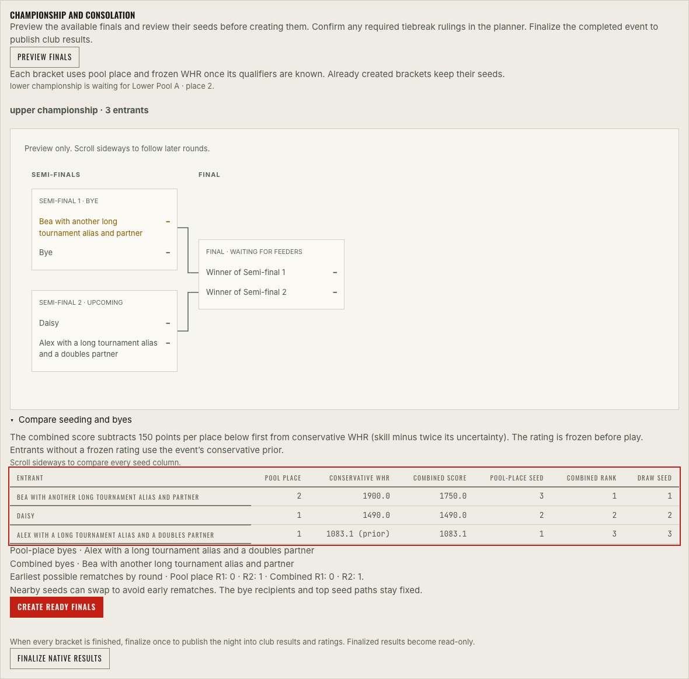
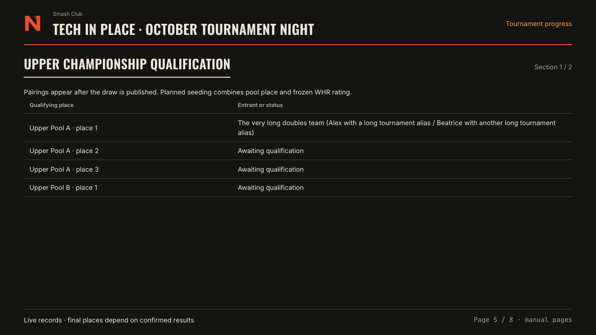
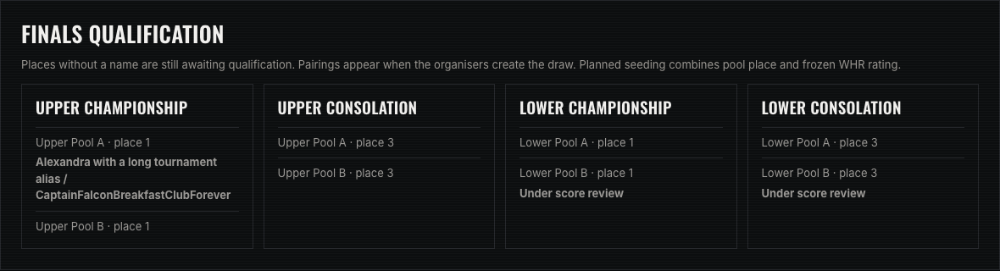
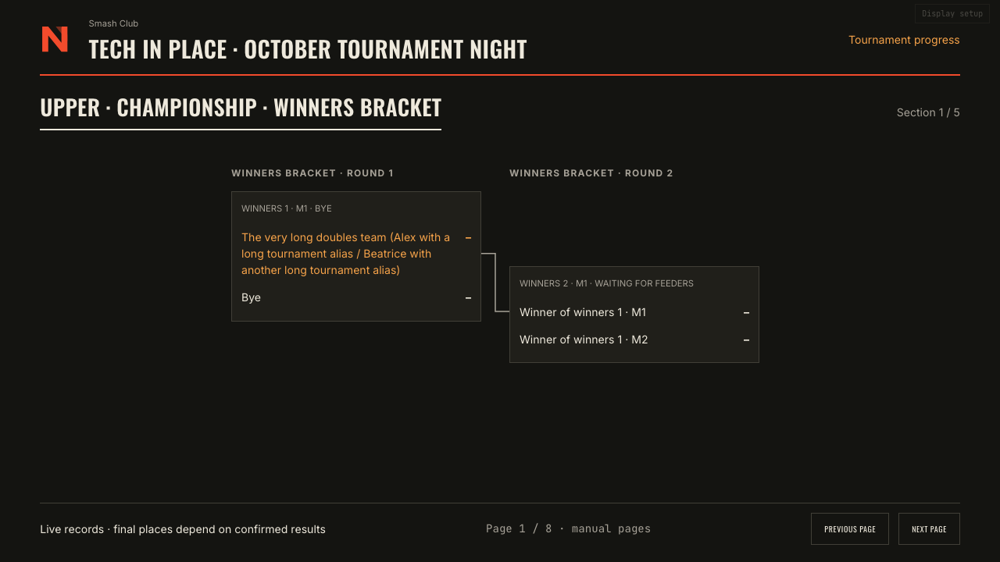
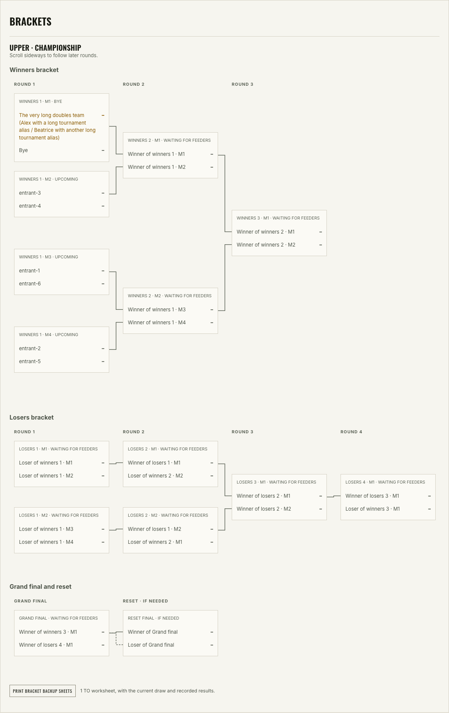

# Nemesis changelog

Dates show when changes landed on main, in Sydney time. Build links identify the corresponding Git commits. Release headings point to versioned application images.

## 0.1.9

### Patch Changes

- 8 November 2026 · **Maintenance** · Validate release notes against the merge commit tested by CI when a release advances the base branch. [#181](https://github.com/ashleylamont/smashclub-seeding/pull/181) · [build 9e0b162](https://github.com/ashleylamont/smashclub-seeding/commit/9e0b1625dd1be606fcf587f944941230c35ba330)

  Verify that each release increments the exact highest patch, minor or major bump declared by its consumed Changesets.

- 8 November 2026 · **Fix** · The organiser desk explains why a pool draw cannot be paused and takes organisers directly to any untaken calls they need to return. A paused draw can resume from the same panel in one step. [#169](https://github.com/ashleylamont/smashclub-seeding/pull/169) · [build f2f4ed8](https://github.com/ashleylamont/smashclub-seeding/commit/f2f4ed8dc7976c08113467e7cd30a574298f9d7d)

## 0.1.8

### Patch Changes

- 8 November 2026 · **Maintenance** · Document the TIP12 bracket replay and verify how two alternative renderers handle pending matches, long names and draw progression. [#168](https://github.com/ashleylamont/smashclub-seeding/pull/168) · [build 8721d14](https://github.com/ashleylamont/smashclub-seeding/commit/8721d14818db11c39d35521401133cd8e948bb6b)
- 8 November 2026 · **Improvement** · Organisers can preview every round of a ready finals bracket before creating it, including automatic byes and where winners advance. [#168](https://github.com/ashleylamont/smashclub-seeding/pull/168) · [build 8721d14](https://github.com/ashleylamont/smashclub-seeding/commit/8721d14818db11c39d35521401133cd8e948bb6b)

  

## 0.1.7

### Patch Changes

- 8 November 2026 · **Improvement** · Find the changelog, app version and build in the site footer. Colour-coded category labels make release notes and historical entries easier to scan. [#172](https://github.com/ashleylamont/smashclub-seeding/pull/172) · [build 45a20eb](https://github.com/ashleylamont/smashclub-seeding/commit/45a20eb91d82f5cbea5479522a1eaefee83153dd)

## 0.1.6

### Patch Changes

- 8 November 2026 · **Maintenance** · Balance the four browser CI jobs using measured test times and verify that every spec belongs to exactly one job. [#170](https://github.com/ashleylamont/smashclub-seeding/pull/170) · [build 63d3d54](https://github.com/ashleylamont/smashclub-seeding/commit/63d3d549c84cfb1ad3324b002a792ab0ea79c43e)

## 0.1.5

### Patch Changes

- 8 November 2026 · **Improvement** · The OBS intermission shows which pool places feed upcoming finals and names confirmed qualifiers while the draw is pending. [#164](https://github.com/ashleylamont/smashclub-seeding/pull/164) · [build c870337](https://github.com/ashleylamont/smashclub-seeding/commit/c8703371def0358c2770c77c9d49f270b2db57c8)

  

## 0.1.4

### Patch Changes

- 8 November 2026 · **Improvement** · See which pool places feed each finals bracket during live pool play. Confirmed qualifiers appear as they become known, and pairings appear when the draw is created. [#162](https://github.com/ashleylamont/smashclub-seeding/pull/162) · [build 23cc78d](https://github.com/ashleylamont/smashclub-seeding/commit/23cc78d5c646180dfa17669e04c7135ace939d9e)

  

## 0.1.3

### Patch Changes

- 8 November 2026 · **Maintenance** · Stabilise the OBS connection-interruption check by advancing the browser clock through polling and retry. [#161](https://github.com/ashleylamont/smashclub-seeding/pull/161) · [build 414cfb6](https://github.com/ashleylamont/smashclub-seeding/commit/414cfb63dc9e93d8e0d64901ef2fce020738b855)

## 0.1.2

### Patch Changes

- 8 November 2026 · **Fix** · Show forfeits and byes by name in archived tournament results, including older Nemesis events. [#156](https://github.com/ashleylamont/smashclub-seeding/pull/156) · [build d485d4c](https://github.com/ashleylamont/smashclub-seeding/commit/d485d4cd7cd359f8402b9e3f64a912547e70d7b3)
- 8 November 2026 · **Maintenance** · Generate version PRs from pending Changesets and publish the verified app image and GitHub release after the version merges. [#158](https://github.com/ashleylamont/smashclub-seeding/pull/158) · [build 38e555b](https://github.com/ashleylamont/smashclub-seeding/commit/38e555b9fa7e77c27c9bcf138c0bc812c52ab9a2)
- 8 November 2026 · **Maintenance** · Accept the release App Client ID from GitHub Actions secrets or variables. [#159](https://github.com/ashleylamont/smashclub-seeding/pull/159) · [build 74e037b](https://github.com/ashleylamont/smashclub-seeding/commit/74e037bd6c3c81ca43721e7e25f150dd8d8f6ff3)

## 0.1.1

### Patch Changes

- 8 November 2026 · **Improvement** · Browse dated changes by build and version, with change categories and screenshots for selected features. [#155](https://github.com/ashleylamont/smashclub-seeding/pull/155) · [build 087de18](https://github.com/ashleylamont/smashclub-seeding/commit/087de18551fd55dc0e32dea71f8aa89d9890fce2)
- 8 November 2026 · **Fix** · Keep long event names, recent results and the score-reporting QR visible together in the OBS gameplay overlay. [#153](https://github.com/ashleylamont/smashclub-seeding/pull/153) · [build 8b5c3c0](https://github.com/ashleylamont/smashclub-seeding/commit/8b5c3c05ecb57fd7e72c9f13618c8e3fc1332547)
- 8 November 2026 · **Fix** · Show how each club night changed a player's skill estimate and attendance penalty, including revisions while they were away. [#154](https://github.com/ashleylamont/smashclub-seeding/pull/154) · [build 6f6c690](https://github.com/ashleylamont/smashclub-seeding/commit/6f6c6908e989d9e23ec100649620e11d6c162cce)

## 0.1.0

Released 8 November 2026 · [release build cecd3d4](https://github.com/ashleylamont/smashclub-seeding/commit/cecd3d4297b78b3fd03531e5f7c016578fa97739)

### Minor Changes

- **Milestone** · Introduce versioned Nemesis releases and a public changelog covering the history of rankings, event planning, live tournaments and broadcasts.

## Before versioned releases

Entries are grouped by their original dates. Milestones mark major changes to the app or its rating model. Features add capabilities, improvements refine existing workflows, fixes correct defects and maintenance covers internal work.

### 8 November 2026

- **Improvement** · Seed native finals with confirmed pool places and frozen WHR. The TO can review seeds, byes and possible rematches before creating each ready bracket. [#151](https://github.com/ashleylamont/smashclub-seeding/pull/151) · [build 6f20a0a](https://github.com/ashleylamont/smashclub-seeding/commit/6f20a0adcd84e04b9a09f677c67ec406496d73c9)
- **Improvement** · Show player or team totals in draft plans, with unresolved entries separate. Frozen plans show actual division and pool sizes. [#150](https://github.com/ashleylamont/smashclub-seeding/pull/150) · [build 04c6a3e](https://github.com/ashleylamont/smashclub-seeding/commit/04c6a3eba709e44152e021d73840ba4716403991)
- **Fix** · Release clear qualifiers from a completed pool while an organiser settles its tied places. [#149](https://github.com/ashleylamont/smashclub-seeding/pull/149) · [build 8f13fc4](https://github.com/ashleylamont/smashclub-seeding/commit/8f13fc42f0ec78a590c4a65d345e688a69f962d1)

### 31 October 2026

- **Improvement** · Explain doubles rating uncertainty and let organisers sort pairs without changing their saved seeds. [#146](https://github.com/ashleylamont/smashclub-seeding/pull/146) · [build 7074d67](https://github.com/ashleylamont/smashclub-seeding/commit/7074d6786fac8d043805e0cdb28b275b095088fc)
- **Feature** · Rotate through tournament progress between streamed sets and switch to gameplay automatically when the selected station starts. [#143](https://github.com/ashleylamont/smashclub-seeding/pull/143) · [build 39e05f6](https://github.com/ashleylamont/smashclub-seeding/commit/39e05f619b27edae4c39f1af19b3289386837138)

  

- **Feature** · Show native draws in the TO workspace, print backup sheets and use match names that describe their bracket paths. [#142](https://github.com/ashleylamont/smashclub-seeding/pull/142) · [build e917d8b](https://github.com/ashleylamont/smashclub-seeding/commit/e917d8b977c555358d99c645a25f61a38986a873), [#138](https://github.com/ashleylamont/smashclub-seeding/pull/138) · [build 5a1e051](https://github.com/ashleylamont/smashclub-seeding/commit/5a1e0514ac8e941280f31b0d0f53b42e743f9408)

  

- **Milestone** · Open live events from Home. Players can follow their own path, find their next match and report scores in one event hub with shared controls. [#141](https://github.com/ashleylamont/smashclub-seeding/pull/141) · [build 21d6edf](https://github.com/ashleylamont/smashclub-seeding/commit/21d6edf2336b4da86e33fdd859ac018678a53d21), [#133](https://github.com/ashleylamont/smashclub-seeding/pull/133) · [build c686082](https://github.com/ashleylamont/smashclub-seeding/commit/c6860826e48f950bef98d68ad8592f6a8aaf0447), [#126](https://github.com/ashleylamont/smashclub-seeding/pull/126) · [build e691620](https://github.com/ashleylamont/smashclub-seeding/commit/e691620e7e16a57974a5264d9d71e6a1d1887d83), [#124](https://github.com/ashleylamont/smashclub-seeding/pull/124) · [build c8f6a67](https://github.com/ashleylamont/smashclub-seeding/commit/c8f6a676bc6abe287fcf101b540eebbb0153408c)
- **Improvement** · Record forfeits without game scores and review the effects of restoring a withdrawn entrant before applying the change. [#137](https://github.com/ashleylamont/smashclub-seeding/pull/137) · [build 85dd7d5](https://github.com/ashleylamont/smashclub-seeding/commit/85dd7d5a35569dd46d2bd3a3fef1d594515b06e4), [#135](https://github.com/ashleylamont/smashclub-seeding/pull/135) · [build 6dab79a](https://github.com/ashleylamont/smashclub-seeding/commit/6dab79a62ab4f3afe56dddc63d3695e51986e0b2)
- **Feature** · Save left and right player sides for OBS and show recent official results beside gameplay. [#134](https://github.com/ashleylamont/smashclub-seeding/pull/134) · [build bd2809f](https://github.com/ashleylamont/smashclub-seeding/commit/bd2809f9a060e262ed3b944d84a2ad94394dc0bf), [#132](https://github.com/ashleylamont/smashclub-seeding/pull/132) · [build 834ef41](https://github.com/ashleylamont/smashclub-seeding/commit/834ef41510e88f175d8ae9fa0a5d633cbffe13fd)
- **Improvement** · Resolve finals qualifiers as pools finish, record unambiguous set-win orders automatically and distinguish a true bye from an unknown opponent. [#131](https://github.com/ashleylamont/smashclub-seeding/pull/131) · [build e0adb4f](https://github.com/ashleylamont/smashclub-seeding/commit/e0adb4f93bdcbf4e623df28418c59c655799ca1e), [#128](https://github.com/ashleylamont/smashclub-seeding/pull/128) · [build 985264a](https://github.com/ashleylamont/smashclub-seeding/commit/985264aa149932f26bf2aa71b75b7a4bb061047f), [#127](https://github.com/ashleylamont/smashclub-seeding/pull/127) · [build 1944abf](https://github.com/ashleylamont/smashclub-seeding/commit/1944abf014c3cd2e95a5853eb8aaf6b3f6649040)
- **Improvement** · Explain unavailable stations and let organisers dispatch matches from shared capacity. Played scores can be reported before a separate Start action. [#130](https://github.com/ashleylamont/smashclub-seeding/pull/130) · [build c6f565e](https://github.com/ashleylamont/smashclub-seeding/commit/c6f565ee3fa081a9c6f398f70b582a7f1f46bbb4), [#120](https://github.com/ashleylamont/smashclub-seeding/pull/120) · [build 72cbf59](https://github.com/ashleylamont/smashclub-seeding/commit/72cbf59f1d60ea18325930033312b5f34c30db6a)
- **Fix** · Show reliable public brackets with measured feeder connections and readable scrolling. [#125](https://github.com/ashleylamont/smashclub-seeding/pull/125) · [build 639ecc5](https://github.com/ashleylamont/smashclub-seeding/commit/639ecc5ffffdfadff6b7f5cd5681cb2fd471d531)
- **Feature** · Keep guest reporting passes valid until an organiser revokes them. [#119](https://github.com/ashleylamont/smashclub-seeding/pull/119) · [build 41a7c47](https://github.com/ashleylamont/smashclub-seeding/commit/41a7c477904f141782a83e3286c5ee7a1a868cb6)

### 24 October 2026

- **Improvement** · Improve double-elimination previews, including feeder labels and the conditional reset final. [#113](https://github.com/ashleylamont/smashclub-seeding/pull/113) · [build 5c2cdb4](https://github.com/ashleylamont/smashclub-seeding/commit/5c2cdb4b60e3a0fd5de584360cc90e472f7ff955)

### 23 October 2026

- **Fix** · Stabilise browser recovery checks and make main use the full release verification workflow. [#112](https://github.com/ashleylamont/smashclub-seeding/pull/112) · [build 041c4bf](https://github.com/ashleylamont/smashclub-seeding/commit/041c4bf9d39ba89ff669344dcdcf288a62dfcb29)
- **Improvement** · Compile native draws for supported pool, round-robin and elimination formats through one format engine. [#111](https://github.com/ashleylamont/smashclub-seeding/pull/111) · [build 2675e7e](https://github.com/ashleylamont/smashclub-seeding/commit/2675e7e4f36bcd4fd5fd747d1f7f750c3cd2472f)

### 22 October 2026

- **Fix** · Update runtime dependencies to address security fixes. [#110](https://github.com/ashleylamont/smashclub-seeding/pull/110) · [build 179291c](https://github.com/ashleylamont/smashclub-seeding/commit/179291c71ce333d5719482c6372c96497dd8e212)
- **Feature** · Preview draft tournament timelines, divisions and bracket layouts before locking the draw. [#109](https://github.com/ashleylamont/smashclub-seeding/pull/109) · [build 5d48250](https://github.com/ashleylamont/smashclub-seeding/commit/5d48250592c755f1ba7eb1e27166a313ee3a3710)
- **Improvement** · Let organisers recover, revert or remove eligible soft-locked plans while retaining their history. [#108](https://github.com/ashleylamont/smashclub-seeding/pull/108) · [build 1faefe5](https://github.com/ashleylamont/smashclub-seeding/commit/1faefe5ea602051bc736263363c92fa3f5eee658)

### 20 October 2026

- **Milestone** · Run native doubles tournaments, choose tournament formats and optionally use WHR pair adjustments for seeding. [#107](https://github.com/ashleylamont/smashclub-seeding/pull/107) · [build 1807cc5](https://github.com/ashleylamont/smashclub-seeding/commit/1807cc5c2871a4f97a11ad7a02b794a1013e28af)

### 10 October 2026

- **Feature** · Show the native tournament history in the TO workspace, including recorded decisions and their effects. [#106](https://github.com/ashleylamont/smashclub-seeding/pull/106) · [build e8b36e5](https://github.com/ashleylamont/smashclub-seeding/commit/e8b36e59c8b7226ee126d3651eef32956438a200)

### 8 October 2026

- **Improvement** · Improve the local event rehearsal and verify recovery after network interruptions. The app shows when it is displaying the last received event state. [#105](https://github.com/ashleylamont/smashclub-seeding/pull/105) · [build 48f8622](https://github.com/ashleylamont/smashclub-seeding/commit/48f862214edf25bfd364481a5d50fa3683435550), [#104](https://github.com/ashleylamont/smashclub-seeding/pull/104) · [build 048871f](https://github.com/ashleylamont/smashclub-seeding/commit/048871fadd6cc7ecf0459abc73c0b5db3469d20b)

### 6 October 2026

- **Milestone** · Make the Act journal authoritative for native live play and retain reviewed result revisions through publication. [#100](https://github.com/ashleylamont/smashclub-seeding/pull/100) · [build 451749d](https://github.com/ashleylamont/smashclub-seeding/commit/451749d7bf6d3922ca1ca94eff587717f8a70498)

### 5 October 2026

- **Milestone** · Publish WHR as the sole ratings model and require database and production image verification before publishing builds. [#102](https://github.com/ashleylamont/smashclub-seeding/pull/102) · [build c129fcf](https://github.com/ashleylamont/smashclub-seeding/commit/c129fcfc0ad578a280cd5b7555629dafb77a4b79), [#103](https://github.com/ashleylamont/smashclub-seeding/pull/103) · [build d0ee0d0](https://github.com/ashleylamont/smashclub-seeding/commit/d0ee0d0d6ac56fbb27121e7a73ec091aa0e2aaa0)

### 4 October 2026

- **Improvement** · Standardise controls, improve score reporting and organise the TO workspace around focused tasks. [#101](https://github.com/ashleylamont/smashclub-seeding/pull/101) · [build 6036b81](https://github.com/ashleylamont/smashclub-seeding/commit/6036b81466faf49860c7c6066fcf0da2085e4b0a)

### 29 September 2026

- **Feature** · Allow native finals to proceed while independent pool matches are still running. [#49](https://github.com/ashleylamont/smashclub-seeding/pull/49) · [build 1f24143](https://github.com/ashleylamont/smashclub-seeding/commit/1f241433340d8c7a51a5204a9b9ac478419fbb63)
- **Feature** · Show an organiser attendee roster with copy filters and links to edit player records. [#48](https://github.com/ashleylamont/smashclub-seeding/pull/48) · [build ddce153](https://github.com/ashleylamont/smashclub-seeding/commit/ddce1537d10dac870fb7569fc98f3a0e87ed07c7)

### 28 September 2026

- **Feature** · Print bracket backup sheets and focus the player view on selected matches. [#47](https://github.com/ashleylamont/smashclub-seeding/pull/47) · [build 93061da](https://github.com/ashleylamont/smashclub-seeding/commit/93061dae83651c1647f19f9a78727bb9cf273b43), [#46](https://github.com/ashleylamont/smashclub-seeding/pull/46) · [build e75a913](https://github.com/ashleylamont/smashclub-seeding/commit/e75a913627522ce09d183dfe9691fb2ff29c6c02)
- **Improvement** · Make pool soft lock explicit and reversible before play. Limit attendance changes to the affected draw. [#45](https://github.com/ashleylamont/smashclub-seeding/pull/45) · [build 94935b4](https://github.com/ashleylamont/smashclub-seeding/commit/94935b40f85180a290742164ca2170124a88b5a9), [#39](https://github.com/ashleylamont/smashclub-seeding/pull/39) · [build 427cfcc](https://github.com/ashleylamont/smashclub-seeding/commit/427cfcceb8bcc8bf19946739469bf081b677171e)
- **Feature** · Manage administrator access in Nemesis and print reusable station QR signs. [#44](https://github.com/ashleylamont/smashclub-seeding/pull/44) · [build d103452](https://github.com/ashleylamont/smashclub-seeding/commit/d103452ce22488826cf28395f9610ddc80289b41), [#40](https://github.com/ashleylamont/smashclub-seeding/pull/40) · [build 49edc59](https://github.com/ashleylamont/smashclub-seeding/commit/49edc59e640f6d73a64e3b1da1edc695c4ac051b)
- **Maintenance** · Add stricter lint and formatting checks, expand event workflow coverage in CI and refresh the development guides. [#43](https://github.com/ashleylamont/smashclub-seeding/pull/43) · [build acd7fca](https://github.com/ashleylamont/smashclub-seeding/commit/acd7fcabaea8d3b5cc6bc558705a2baef218f241), [#42](https://github.com/ashleylamont/smashclub-seeding/pull/42) · [build f9deb93](https://github.com/ashleylamont/smashclub-seeding/commit/f9deb93ab80a4f6a983dee6cbd3bdee9b0fc1827), [#41](https://github.com/ashleylamont/smashclub-seeding/pull/41) · [build 5db20a4](https://github.com/ashleylamont/smashclub-seeding/commit/5db20a45e4a9f279888221ee316fb8317fb5c63c)

### 26 September 2026

- **Feature** · Show TO breakthrough analysis and let players find their pool, next set and station call. [#38](https://github.com/ashleylamont/smashclub-seeding/pull/38) · [build 48b9e51](https://github.com/ashleylamont/smashclub-seeding/commit/48b9e511e996fe5d785ddd3e7ef4c5e2618b7a58), [#33](https://github.com/ashleylamont/smashclub-seeding/pull/33) · [build d21d06c](https://github.com/ashleylamont/smashclub-seeding/commit/d21d06ca9b39bdcc414e69eeb214371c9337c6f1)
- **Feature** · Manage event stations and print pool sheets with pairings and live-board QR codes. [#37](https://github.com/ashleylamont/smashclub-seeding/pull/37) · [build 824b255](https://github.com/ashleylamont/smashclub-seeding/commit/824b2552d2468405b4db3d18bcd1e2ac5e2ab208), [#34](https://github.com/ashleylamont/smashclub-seeding/pull/34) · [build 41eef87](https://github.com/ashleylamont/smashclub-seeding/commit/41eef87be64b6ad3140ad01e17979f23e6b4f12d)
- **Feature** · Open the event-night player hub without an account and allow scores to be approved automatically unless disputed. [#35](https://github.com/ashleylamont/smashclub-seeding/pull/35) · [build ef35315](https://github.com/ashleylamont/smashclub-seeding/commit/ef353155fbd64a9516aa3cc9e27e5e1790abec05)

### 21 September 2026

- **Feature** · Group score reviews and match decisions in the TO attention desk. [#32](https://github.com/ashleylamont/smashclub-seeding/pull/32) · [build fecb2ed](https://github.com/ashleylamont/smashclub-seeding/commit/fecb2edb08b1b73f8f6bff94b5b7775249398db0)

### 19 September 2026

- **Feature** · Let pools use their own station queues and confirm their scores. [#31](https://github.com/ashleylamont/smashclub-seeding/pull/31) · [build bb115a4](https://github.com/ashleylamont/smashclub-seeding/commit/bb115a4bc76a4b5465b6480b03fb9bf8aaef333f)

### 18 September 2026

- **Milestone** · Run live Nemesis nights with guest reporting, station management, finals, broadcast views and publication. Adopt completed historical events while keeping their original results. [#30](https://github.com/ashleylamont/smashclub-seeding/pull/30) · [build 0de3fd5](https://github.com/ashleylamont/smashclub-seeding/commit/0de3fd5c89a045a88c282fe760060a2b2bea856d), [#29](https://github.com/ashleylamont/smashclub-seeding/pull/29) · [build d2aa591](https://github.com/ashleylamont/smashclub-seeding/commit/d2aa5912b5196297a497c5b0a841100d6ae39f5a), [#28](https://github.com/ashleylamont/smashclub-seeding/pull/28) · [build 4cd455b](https://github.com/ashleylamont/smashclub-seeding/commit/4cd455be39ad63596b65595981e2f07fe78b7ebe)

### 8 September 2026

- **Improvement** · Refresh recent events and distinguish group-stage sets in ratings views. [#27](https://github.com/ashleylamont/smashclub-seeding/pull/27) · [build 612fbe0](https://github.com/ashleylamont/smashclub-seeding/commit/612fbe034f80bf82950fef53057c7e3efdee5fbe)

### 4 September 2026

- **Feature** · Support two-stage results, event standings and curated club-night recaps. [#26](https://github.com/ashleylamont/smashclub-seeding/pull/26) · [build d424e2a](https://github.com/ashleylamont/smashclub-seeding/commit/d424e2abeabfeea10f9b98bd61ecc346c2cf8f6f)

### 24 August 2026

- **Feature** · Plan two-division tournaments, seed players and prepare pools before the event. [#25](https://github.com/ashleylamont/smashclub-seeding/pull/25) · [build c8e9441](https://github.com/ashleylamont/smashclub-seeding/commit/c8e9441abc4e5410888dffedc1a708fdc5a651ec)

### 6 August 2026

- **Improvement** · Hide players who have been inactive for six months by default. [#24](https://github.com/ashleylamont/smashclub-seeding/pull/24) · [build d349885](https://github.com/ashleylamont/smashclub-seeding/commit/d3498859c8d6ec4f3560536fd12e54d659064aec)

### 3 August 2026

- **Fix** · Name the whole club night on inactivity rows shared by multiple brackets. [#22](https://github.com/ashleylamont/smashclub-seeding/pull/22) · [build 9b20ad2](https://github.com/ashleylamont/smashclub-seeding/commit/9b20ad265363ab99f461f7fa445ed3ea11d38dbc)

### 2 August 2026

- **Fix** · Base recap awards on eligible played results and show sets in play order. [#21](https://github.com/ashleylamont/smashclub-seeding/pull/21) · [build a2fc34c](https://github.com/ashleylamont/smashclub-seeding/commit/a2fc34c6eb2566ade8d0b5e9ffa8ace254e0a818), [#20](https://github.com/ashleylamont/smashclub-seeding/pull/20) · [build d06d2fb](https://github.com/ashleylamont/smashclub-seeding/commit/d06d2fb934c391ab2705257f0ac3454211193fc8)
- **Milestone** · Add Whole-History Rating and calibrate rookie debut ratings and exposure to the established field. [#19](https://github.com/ashleylamont/smashclub-seeding/pull/19) · [build c1718dc](https://github.com/ashleylamont/smashclub-seeding/commit/c1718dc3a9ec30df596ad45e9320490c2068d7ce), [#16](https://github.com/ashleylamont/smashclub-seeding/pull/16) · [build a6cdc09](https://github.com/ashleylamont/smashclub-seeding/commit/a6cdc095f246f87a22088c23438cf33cc1e0843f)
- **Improvement** · Publish aliases across public views and link the build stamp to the serving Git commit. [#18](https://github.com/ashleylamont/smashclub-seeding/pull/18) · [build 4171d04](https://github.com/ashleylamont/smashclub-seeding/commit/4171d04eeefe71b9b7deb6e9062df7427ed5a04d), [#17](https://github.com/ashleylamont/smashclub-seeding/pull/17) · [build 60f10e8](https://github.com/ashleylamont/smashclub-seeding/commit/60f10e8fc814e0feb4357dd5721f3f3e6467ef52)

### 1 August 2026

- **Improvement** · Improve inactivity handling and default the rankings to the active field. [#15](https://github.com/ashleylamont/smashclub-seeding/pull/15) · [build 57d886b](https://github.com/ashleylamont/smashclub-seeding/commit/57d886bd7ed3ff32083274a3fed4bfacbdc1d079), [#13](https://github.com/ashleylamont/smashclub-seeding/pull/13) · [build 04710a4](https://github.com/ashleylamont/smashclub-seeding/commit/04710a41d63111e304d7425fa238a97e74939f0b)
- **Feature** · Add event recaps, share cards and venue mode. Improve mobile layouts and explanations of rating changes. [#14](https://github.com/ashleylamont/smashclub-seeding/pull/14) · [build 9753892](https://github.com/ashleylamont/smashclub-seeding/commit/975389224213233eecf55d035edafc1a3a2570a5), [#11](https://github.com/ashleylamont/smashclub-seeding/pull/11) · [build d024a38](https://github.com/ashleylamont/smashclub-seeding/commit/d024a380ce73a9429b0449fa27e8903855f7245f)
- **Maintenance** · Give CI checks individual statuses and remove clock reads during React render. [#12](https://github.com/ashleylamont/smashclub-seeding/pull/12) · [build 36951d8](https://github.com/ashleylamont/smashclub-seeding/commit/36951d8320cc8af9d7cd962348e59cae4c8294d8), [#8](https://github.com/ashleylamont/smashclub-seeding/pull/8) · [build 741d232](https://github.com/ashleylamont/smashclub-seeding/commit/741d2324fcac532a524017631106e500d6beec96)
- **Improvement** · Improve administrator revocation and connection limits. Default public aliases to first names and initials and retain chosen aliases. [build bfd7c8b](https://github.com/ashleylamont/smashclub-seeding/commit/bfd7c8bf6e46d2fa7eaa960dafbc87870ef6a7f9), [build 1407081](https://github.com/ashleylamont/smashclub-seeding/commit/14070816b35e97eaf3991b2328f6b292cc96034a)
- **Feature** · Resolve match participants through the player registry and import registry files in the admin UI. [#9](https://github.com/ashleylamont/smashclub-seeding/pull/9) · [build 1c4e370](https://github.com/ashleylamont/smashclub-seeding/commit/1c4e370156cbc65313f44199b814393dfce2eae6), [#7](https://github.com/ashleylamont/smashclub-seeding/pull/7) · [build 4ab05bf](https://github.com/ashleylamont/smashclub-seeding/commit/4ab05bf2d1f348cce8f402f1a1f93a6b3de2c615)
- **Fix** · Keep YAML loading compatible with the server build. [build b249ecc](https://github.com/ashleylamont/smashclub-seeding/commit/b249ecc208e98e0a188ef44c6b951aca91be1c5f)
- **Fix** · Correct live tournament grouping, reduce Challonge requests and repair the public bracket fallback. [#6](https://github.com/ashleylamont/smashclub-seeding/pull/6) · [build 22a2d70](https://github.com/ashleylamont/smashclub-seeding/commit/22a2d70e02cc8b1c10b7009160809bb54b124fa5), [#5](https://github.com/ashleylamont/smashclub-seeding/pull/5) · [build 2cad67f](https://github.com/ashleylamont/smashclub-seeding/commit/2cad67fc08af018783fa000e8fe503b34af8a786), [#3](https://github.com/ashleylamont/smashclub-seeding/pull/3) · [build e2e6842](https://github.com/ashleylamont/smashclub-seeding/commit/e2e68420c7c01177a092f6fd167b1fba668cfa8e)
- **Feature** · Add player profiles, character mains, company administration and provider-independent sign-in. [#4](https://github.com/ashleylamont/smashclub-seeding/pull/4) · [build 5b48bec](https://github.com/ashleylamont/smashclub-seeding/commit/5b48bec05b019a557e370bc37f70e63bbd5d9697)

### 29 July 2026

- **Milestone** · Turn the seeding CLI into the Nemesis web app with persistent rankings and publish container images to GitHub Container Registry. [#2](https://github.com/ashleylamont/smashclub-seeding/pull/2) · [build f180b5a](https://github.com/ashleylamont/smashclub-seeding/commit/f180b5aa9fe41aa22969a9ff2984a70f70a108bc), [#1](https://github.com/ashleylamont/smashclub-seeding/pull/1) · [build afa8550](https://github.com/ashleylamont/smashclub-seeding/commit/afa8550d49c2f68ec9ba792b570bcc56ec947d8d)

### 23 March 2026

- **Milestone** · Add a Glicko-based ranking system to the original toolkit. [build f213c51](https://github.com/ashleylamont/smashclub-seeding/commit/f213c5104abac70a590de6fd24b5796ad6f5a7d2)

### 4 March 2026

- **Maintenance** · Add the project licence. [build 4ef964e](https://github.com/ashleylamont/smashclub-seeding/commit/4ef964e7e3db5cefa6af90eacd6a9c105eb7559e)

### 3 March 2026

- **Maintenance** · Use fictional player names in the test fixtures. [build 734ea58](https://github.com/ashleylamont/smashclub-seeding/commit/734ea58aa0bd3439e32e564db155023689595710)

### 2 February 2026

- **Improvement** · Improve terminal colours and move formatted output into its own module. [build f7deb39](https://github.com/ashleylamont/smashclub-seeding/commit/f7deb3930fe4ea4da5f171adff3b069ecfc0edff), [build 7ae1dcf](https://github.com/ashleylamont/smashclub-seeding/commit/7ae1dcf5d05a1b4225f371f9f3cbc8b7cd24b2aa)
- **Improvement** · Refine placement and peak-performance weighting. [build 2dd2c0a](https://github.com/ashleylamont/smashclub-seeding/commit/2dd2c0a021a2f801e1e15263dc98ae25e016abb9)

### 1 February 2026

- **Fix** · Document the toolkit and fix terminal output. [build 4b7cdc1](https://github.com/ashleylamont/smashclub-seeding/commit/4b7cdc1a06116c934d4479806057af0586727a6d)

### 30 January 2026

- **Maintenance** · Expand the company lookup table. [build e69a0af](https://github.com/ashleylamont/smashclub-seeding/commit/e69a0af4d1a3d1fdd5cd8158842cbeace5fc1edc)

### 9 January 2026

- **Improvement** · Use doubles results to supplement rookie evidence and adjust recent-result weighting. [build 4ab0b96](https://github.com/ashleylamont/smashclub-seeding/commit/4ab0b96b5786f75f4efe73848198faa8406d7e0e)

### 28 October 2025

- **Improvement** · Refine rookie seeding adjustments in the original ranking tool. [build 5da0df1](https://github.com/ashleylamont/smashclub-seeding/commit/5da0df15cf2799c792851f29e4a4fc1b677ac948)

### 20 October 2025

- **Milestone** · Start the Smash Club seeding toolkit and document its purpose. [build d22c8e3](https://github.com/ashleylamont/smashclub-seeding/commit/d22c8e3278c9d8976c9487730ff026c20e7f018c), [build 51106fc](https://github.com/ashleylamont/smashclub-seeding/commit/51106fca5cfc085f5ba26e6375340c65db4613dc)
